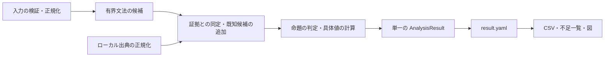

# 現行実装の責務

1.0の目的は、物理対象と必要条件を入力し、候補・根拠・数値の利用結果を調査することです。通常の入口はCLI `analyze`、内部の入口は `pipeline.analyze(Case, EvidenceCatalog)` です。同じ目的の入口は同じ処理と `AnalysisResult` を共有します。データベース固有の形式は入口で正規化し、出典を変えても同じ命題は同じ評価処理へ渡します。

## 依存方向

`case` が入力境界、`model` が候補型と保存結果の共通投影規則、`records` が出典付き科学データ、`units` が単位規則です。`generate` と `evidence` は独立し、`assessment` が両者の関係を評価します。`numeric` は元の数値量の利用可否と評価、出典選択、係数用途への適合を区別します。`selection` は利用者の量別・対象別採用要求です。物性・NASA・数値記録は同じ要求型を使い、異なる量の定義や参照条件を出典順位だけで同一化しません。`thermo` は選択された入力の熱化学算術と参照条件の整合を担当し、出典の承認や反応の発生を判断しません。`pipeline` は順序を組み立て、`Case.data_selection` を評価へ渡します。`export` が正規保存と読込みを担い、`needs` と `views` は保存結果を表示します。ネットワーク取得は `acquire` に閉じています。

原反応項の形式検証は`model.validate_stoichiometric_terms`に置き、外部・科学記録の入口で合算前に使います。科学的候補そのものは不正を含めて整合判定の対象にでき、同じ規則の違反を`fail`へ写像します。Registryの未登録参照は通常読込みの入力エラーです。採用対象の検証は共有`evaluate`入口で行い、CLIと直接評価の契約を分けません。

同種項の合算・正味係数・元素と電荷の差は、保存される係数の十進表記を使う共通算術に置きます。絶対閾値で小さい寄与をゼロにせず、元の寄与を相殺してからfloatへ戻します。左右の表示totalが丸めで同じでも、保存則の差は元項から保持します。物理的不確かさや元資料の未保存桁を推定する処理ではありません。経路・行列の表示も同じ係数投影を使い、JavaScript側で別のゼロ閾値を設けません。

取得元の構造と要求対象の照合は`acquire.targets`に置きます。各adapterは独立に返された組成・構造識別子・名前を渡し、queryを同定根拠にしません。構造未指定の多原子分子では取得元の構造を対象へ保持します。原記録は欠値も含めて不変で、別出所の値は独立記録の量別選択へ渡します。

照合できた要求別名も、取得元の独立した構造IDへ統一します。queryと要求対象の表記は既存の`source_declaration.acquisition.request`へ分け、同じ科学記録の内容差にしません。PubChemの質量照合は物理同定の後で行い、既存質量の有無で構造照合を省略しません。完全SMILESとConnectivitySMILESの識別範囲も区別します。

YAML読込みは`yamlio`にまとめ、明示した重複キーを構築前に拒否します。既存のalias・mergeの明示上書き規則は維持します。LibYAMLがある環境ではsafe実装を使い、無い環境でも同じ検証を行います。数値形式の変換は`records.normalized_number`、物性mappingの入口は共通の`normalized_properties`で扱い、内部型では数値以外を受け付けません。形式不正と、数値として保存できるが科学的に不正な宣言を区別します。

## 決まることと決まらないこと

| 処理 | 決まること | 決まらないこと |
|---|---|---|
| 入力境界 | 型・単位・対応語彙、使う条件、明示上限 | 未入力の物理条件 |
| 候補生成 | 文法に従う組成・状態・反応式候補 | 実在性、構造、障壁、速度、全化学の網羅性 |
| 証拠同定 | 電荷・相・構造・状態・解像度の対応と競合 | 曖昧さを解消する無根拠の選択 |
| consistency | 保存則と宣言した過程の式パターン | 反応の実現、エネルギー散逸機構 |
| state | 名前付き命題の存在支持、または基底アニオンの電子束縛支持 | EAだけからの観測存在・寿命・他崩壊経路への安定性、解像度の採用方針 |
| 状態のthermochemistry | 競合していない審査された形成量または対象相に対応する有効なNASA表現が少なくとも一つある | 指定温度の利用可否、全必要量の採用成功、存在、反応障壁 |
| 反応のthermochemistry | 実対象に対応するエネルギー関係の宣言整合・モデル内の条件 | 熱化学量の計算可否、値があるだけの実現性、EEDF、反応障壁 |
| thermochemical_calculations | ΔH・標準ΔG・数密度形Kそれぞれの計算値、条件、不足または範囲外 | エネルギー命題の成立、反応発生、逆チャネル、誤差伝播 |
| reaction_evidence | 当該product-resolvedチャネルの根拠 | total過程の分岐、機構全体の完成 |
| DatasetAssessment | 元の係数・断面積曲線・確率の対象、資格、表現、適用性。scalar量は指定条件での値 | 曲線の暗黙の点評価、EEDF積分、表面速度、反応発生 |
| data_use | 係数用途に使う表現の選択、具体的係数または必要な条件・変換 | 分布・積分・fluxの実行、機構の時間発展 |
| kinetics | 保存されたDataUseから導く係数利用可否 | 数値記録の再評価、反応発生 |
| 数値の出典選択 | 適格な記録から明示要求に合う採用候補 | 記録の科学的承認、同定不足・適用条件不足の解消 |
| 図の経路 | 明示供給からのAND型候補到達性 | 時間順序、支配反応、観測可能性 |

各層の否定は、その命題についての否定です。不正な速度データを現象の不存在へ読み替えません。無関係な励起準位の追加で別の状態の存在判定は変わりません。lumpedとresolvedの重複はmembershipを根拠に記述し、存在判定や自動選択と混ぜません。状態を移すquenching等で別の非基底準位・電子項が終状態になる場合は、現行のground終状態template外としてconsistencyをunknownにします。保存則や相・構造の不一致は別に検出し、式形から準位のエネルギー順序を推測しません。

現行の状態と反応の`thermochemistry`は上表のように異なる命題です。状態側は温度入力を取らず、表現有無のpassから指定温度のH/G計算を保証しません。`Assessment.proposition` は `thermochemical_representation_availability` と、反応の `ionization_threshold_lower_bound` 等のエネルギー関係を区別します。状態の `state` も存在根拠とEAからの基底アニオン束縛の命題を区別します。全判定に新しい必須契約を課すものではありません。

反応threshold・deltaEは `energy_properties` の独立Propertyに保持し、値の読取getter以外のscalarを内部に二重管理しません。旧外部scalarは読込みadapterで一度だけ正規化し、原宣言を保全します。明示した量の資格をチャネルのtierから昇格させません。形成量・NASAによる計算は、これらを使うエネルギー命題とは別の結果です。

EAからの電子束縛は一つの共通処理を状態と付着で使います。正のEA範囲と電子非束縛宣言の矛盾は未確定とし、そのEAだけを数値利用から除外します。`unstable/transient`は電子非束縛の語彙ではありません。短寿命の存在宣言だけでは束縛や不存在を決めず、独立した存在根拠・EAを保持します。

`consistency`はfamilyから適用する式patternを選びます。電子衝突の解離と、電子を含まない単分子解離を区別し、中性・イオンの2粒子→1粒子会合には保存則と式形だけを確認します。未対応の誘起機構・高分子数会合は`unknown`、保存則違反や定義済みpatternとの矛盾は`fail`です。式形の`pass`から素反応、発生条件、速度次数、会合の安定化、解離の励起起源・エネルギー配分を決めません。これらの不足は数値データや熱化学の責務で保持します。

表面familyは明示した材料reservoirを必要とし、気相familyへの壁の混入とは区別します。既知の式patternに追加colliderを併記しただけでは、その誘起機構のモデルを承認しません。式形矛盾は`fail`、式形は合うがcolliderの役割を現モデルで定義できない場合は`unknown`として担当するモデル作業を示します。

## 判定の意味と不足の保存

利用者へ返す全判定は `Assessment.proposition` と個別の `scope` を持ちます。存在支持、電子束縛、表現の有無、式形、エネルギー関係、根拠支持、係数利用を区別します。反応の `participant_state_support` は各参加状態の名前付き命題の集約で、`dependencies` が保存された状態の判定を指します。参加状態の集約とDataUseからkineticsへの投影規則は`model`に一つずつ置き、評価時と保存整合検証で共有します。EAによる電子束縛のpassは付着側でも同じ結論で、安定化・速度・発生を追加の成立条件にしません。

`Requirement` は結論または利用結果に必要な対象・量・作業・理由です。利用可否を確認した処理が返し、入力、出典情報、資料審査、同定、モデル未対応、変換を区別します。数値結果の不足はこのtyped workを正とし、従来の`required_inputs/required_transforms`は共通の投影で導きます。入力・変換配列を別に更新せず、通常利用者が埋める条件と資料・モデルの不足を混ぜません。数値利用の不足はDataUseに置き、kineticsへ複写しません。全関数へ契約を付ける型ではありません。

熱化学計算の不足をエネルギー命題の要件へ足しません。エネルギー関係が未対応でも、独立に計算できたΔH/G/Kを保持します。電荷交換の値・区間比較・必要量・不足説明は、同じ実対象の対応処理を使います。別相・別構造・非基底生成物などで式が適用できない場合は、IE/EAの資料追加で解決すると案内しません。

`Property.definition` は量ごとの意味を保持します。現在のIE/EA利用には対応するgas・ground対象とatomicまたはadiabaticの定義が必要で、同定された単原子groundの旧値もその対象の範囲で扱います。vertical値や定義不明な分子値は原資料へ残し、groundエネルギー比較へ流用しません。原子取得はその量のatomic定義を保存します。出典形式だけで定義を補いません。背景は[NIST gas-phase ion thermochemistry](https://webbook.nist.gov/chemistry/ion/)、不確かさの解釈は[NIST TN 1297](https://www.nist.gov/pml/nist-technical-note-1297/nist-tn-1297-7-reporting-uncertainty)を参照してください。

CSV・CLI・HTML・needsは保存された命題・値・条件・不足から導き、英文messageを解析して科学的に再判定しません。具体的な必要情報は対象・量・責務でまとめ、明示参照から派生した同じ作業を重複計数しません。各対象と理由・影響先は詳細に保持し、分類の一致を原因の一致と扱いません。

## 熱化学計算

`ThermochemicalCalculation`はΔH・標準ΔG・数密度形Kの独立した計算結果です。`computed / needs_input / unavailable / out_of_range`、値・単位・理由・必要作業・使用条件を持ちます。温度未入力、出典の参照不足、モデル未対応、適用範囲外を区別し、一つの量の不足で他量を消しません。参照形成量のΔHと温度を使うNASA計算を同じ計算にしません。

`delta_h_eV`は共通の明示参照条件にある形成量の差です。`Property.formation_reference`が参照温度、標準元素基準、標準圧力、有限温度のイオンで必要な電子規約・電子形成量を保持します。`delta_h_reference_temperature_K`・`delta_h_standard_pressure_Pa`はNASA計算の`temperature_K`と別です。Hfの上限・近似等の自由注記を点値として消費せず、元記録へ残します。形成ΔHは出現閾値・障壁・発生を決めません。

熱化学用の参加種量は一度選び、`net_stoichiometry`の正味係数に寄与する状態だけに量・参照条件を要求します。同一状態が両側で打ち消される場合、その状態の欠測や競合は差に作用しません。相・構造・状態が違う項は打ち消しません。衝突参加者、式pattern、状態支持、速度次数からその粒子を削除する処理ではありません。

NASA7のΔH/RT・ΔS/R差から標準ΔGとKを一回の算術で導きます。正味寄与する気相基底状態のモデル、共通の標準圧力、範囲内温度を必要とし、電子チャネルと表面reservoirを含む反応は現行計算の対象外です。気相だけの値を表面反応全体の熱化学としません。モデルの相が状態の相と異なる場合も、その状態の表現として承認しません。全ての参加状態が明示された気相基底状態で正味係数がゼロなら、恒等的にΔG=0・K=1と計算でき、NASA係数・温度・標準圧を要求も記録もしません。これは状態の存在・モデル表現の有無・他のエネルギー命題の承認とは別です。

数密度形は`K_n=exp[-ΔG°_mol/(RT)](N_A p°/(RT))^Δν`です。ここでΔG°_molはJ/mol、p°はモデルと共通の標準圧力、Δνは生成物−反応物の正味係数合計です。出力ΔGはeV/event、Kの単位は`m^(-3Δν)`で、係数の逆反応対応や非平衡系の方向を決めません。根拠は[Canteraの標準状態と標準濃度](https://www.cantera.org/stable/cxx/d7/dfa/classCantera_1_1IdealGasPhase.html)と[種の熱力学](https://cantera.org/stable/reference/thermo/species-thermo.html)です。

`Evaluation.thermochemical_calculations`を計算値の正とします。`energy_values`にはエネルギー命題の補助値を置き、`thermochemistry`は両者の読み取りMapping viewです。反応ごとのアクセスで成功計算と条件を投影し、全反応値の再複製をせず、異なる責務の同名量上書きを拒否します。従来の`get/items/lookup`は使えますが、取得した辞書の変更で正規値は変わりません。保存したflat値もこの投影で作ります。

## 生成と同定

`EvidenceCatalog`は変更不能な証拠snapshotです。入力記録を独立して保持し、公開取得・照合で返す記録も独立したコピーにします。取得記録の辞書を編集しても元の索引は変わりません。更新は新しいcatalogの構築・読込み、または`dataclasses.replace`で行い、索引と実際の記録内容のfingerprintを再構築します。fingerprintは正規科学内容・数値記録・材料と読込み元のファイル内容を含み、手動構築した異なる証拠も区別します。評価時のasset完全性確認とは別の責務です。

状態照合の`records`はexact、またはexactが無い場合のcompatible記録です。同組成・電荷でも別構造・相・準位等の関連資料は`related_records`へ分けて保存し、exactの存在で消しません。評価・量別選択は引き続き照合された`records`だけを使います。`rgen records`は保存した照合groupから`target_match`を導き、資料自身の対象・相・構造・状態を表示し、関連資料の表示を利用資格へ昇格しません。

生成資格は組成規則と明示した入力範囲で決め、feed/fragment/rearranged等の履歴で物理性質を決めません。状態・反応が増えなくなるまで規則を再適用します。pairの両側解離と、既存テンプレートの自己衝突を調べます。新しいpooling等の機構を推測で追加しません。上限に達した場合はclosureとは報告しません。

入力種の励起とion ligand-transferの相手は入力ground-state種という文法範囲を持ちます。neutral abstractionは別の組成規則で相手を決めます。既知状態や反応を証拠から追加した後に、機械生成をもう一度自動で閉包しません。`completion.mechanical` と `completion.attested` を別に記録し、総候補上限は証拠追加にも適用します。

候補IDは組成、電荷、状態ラベルと、必要な相・構造・種別・解像度を区別します。多価電荷は `Ar^2+`、二原子の一価電荷は `Ar2+` です。構造・相が不足したレコードは同一化しません。NASAの気相値を固相や同式の別構造から選びません。

EA、IE、電荷交換が必要とする対応基底状態は、組成、電荷、相、構造と基底状態の一致に加えて一意性を要求します。電荷交換の生成物もこの対応を確認します。elasticの内部エネルギー差ゼロは、左右の物理対象が同一の場合だけ返します。過程名や候補の挿入順からエネルギー関係を補いません。

式では第三体と壁を明示し、直接付着・再結合の安定化が不明なら `stabilization=unspecified` と記録します。原子・電荷が保存される式から光子や壁へのエネルギー収支まで成立したとは判断しません。

## 数値と根拠

単位、対象、適用域、出典資格、ファイルの保存実測hashと作者の宣言hashを保持します。数値表は、保存実測hashと宣言hashを照合した同じbytesから解析・計算します。再読込みで保存hashを現在値へ置換せず、読込み後のfile変更でも旧資格のまま新値を使いません。採用コピーも保存したbytesを検証し、宣言hash不一致の原記録を保全しても計算資格を与えません。Property、存在根拠、反応レコード、数値datasetを相互に自動昇格しません。overlayのnullは有効な値を遮らず、負の宣言や競合は消しません。

`SourceRef` はprovider、collection、release、原record ID、citation、URL等の明示された出典識別子を持ちます。`method` は measured / evaluated / calculated / estimated / unknown、`tier` は数値や存在根拠の資格、`review_scope` は宣言された審査対象です。取得先名から方法や資格を推定しません。`source_declaration` には入口の原宣言・補足を保全します。

明示した `review_scope` は、存在宣言では `state_existence`、各Propertyではその物性名、NASAでは `thermochemical_model` の資格を制限します。反応記録は `channel_assertion`、`threshold_eV`、`delta_e_eV` をそれぞれ確認します。scopeは承認を与える命題、statusは科学宣言自体の受理・拒否状態です。資格を持つtierでもscope外の命題と `status: rejected/conflicting` の宣言は採用しません。親科学記録が拒否・競合状態なら、その中のProperty・NASAも利用せず、個別量の審査で記録全体を復活させません。存在根拠の審査から別のProperty・NASAを承認しません。

Propertyの `qualifier` は非束縛等の科学的な宣言であり、管理上のstatusと区別します。部分的に否定・未確定の存在主張と、利用可能な物性を別資格で保持する場合は独立記録へ分けます。宣言の拒否を物理現象の不存在へ読み替えません。

空または省略scopeを持つ従来記録は、各型の既存資格を互換として維持します。数値宣言を持つsnapshotのscope省略時は、その数値量へ正規化し、係数の審査からチャネルやthresholdを承認しません。scope外の存在主張は競合を作らず、同一反応record IDの競合は審査された各主張の投影で比較します。

同一対象の存在主張が相反しても、物理照合はexactを保持し、存在命題だけをunknownにします。独立した物性・NASAは自身の資格と条件で評価します。threshold/deltaEの競合・不正値も量ごとに除外し、イオン化下限はthreshold、電荷移動の比較はdeltaE、elasticの内部エネルギー整合は両量の競合を確認します。Penningの励起量/IEと付着のEAは独立に評価し、除外量を既存messageへ残します。真の同定曖昧、拒否された宣言、必要量の競合による利用停止は維持します。

数値datasetも明示scopeがあれば、その `kind` が審査範囲に含まれる場合だけ数値資格を使用します。チャネルだけの審査で速度係数を承認せず、速度係数だけの審査で閾値を承認しません。

`DatasetAssessment`は元の量の評価です。`kind/observable/scope`とtyped requirementsを保存し、指定条件で係数または確率を評価します。断面積は宣言エネルギー域と数値表を持つ曲線として確認し、暗黙に一点を選んだscalar valueを返しません。曲線の資格に電子分布・積分の完了を要求せず、確率の資格に流束変換の完了を要求しません。

`DataUse`は係数を利用する目的の結果です。利用できる直接係数があれば、独立曲線・確率の変換不足でその係数を消しません。曲線からの係数には明示した分布と積分、確率からの表面速度には入射モデルと変換を要求し、元の量の評価へその作業を混ぜません。運動量移行断面積は反応衝突断面積とは別量なので、EEDF積分だけで反応係数へ変換できるとは扱いません。必要な別量の取得を示し、有効な元曲線は保持します。

数値の拒否は個別除外、競合は確認待ち、数値未入手は欠測として、表現形式に先立って区別します。拒否・競合した親反応記録内のofferも利用を停止しますが、原datasetを変更せず、独立overlayや別の有効な親記録のofferを保持します。kineticsは提供記録と条件に限る係数可用性をDataUseから投影し、除外記録を修復する作業と、別の適格係数を利用する前提を混ぜません。

独立した状態科学記録は、overlayの `state_records` とRegistry種ファイルの `records` に保存します。対象IDと科学record IDを分け、同一対象の物性・NASA・存在宣言を出典ごとに保持します。物性の競合はその量の選択を未確定にし、無関係なNASAや状態同定を失わせません。NASA表現の同等性は係数・温度域・相・標準圧力で比べ、出典名の違いだけで競合にしません。元記録は保存します。

数値の明示 `id` は全体で一意な正規IDです。`reaction_target`は対応する正規物理チャネル、`declared_target`は入口で明示された反応式・過程・環境等の構造化した宣言です。既存の原宣言自由文からこれらを推測しません。対象照合とIDの異対象割当て検査を読込み・統合・評価・ingest/adopt・保存で共有します。同対象での再取得や数値の競合とは区別します。正規IDを省略した場合、原資料の `record_id` はprovider・collection・release・source_idの名前空間で区別します。同じ原記録の内容変更は同IDの競合として検出します。原記録IDもなければ科学宣言と正規出典情報からcontent IDを生成します。同じ検証済みbytesの保存場所だけは科学内容比較から分け、原参照path・原宣言・各取得来歴は保全します。bytesが検証できない参照の同一性を推測しません。

新しい状態snapshotの `record_id` または `source.record_id` も同じ名前空間で識別します。原IDがなければ科学宣言と出典から `local-state` IDを生成します。保存済みoverlay・Registryの `record_id` は正規IDとして保持し、旧IDを再生成しません。同じ原IDと出典を持つ旧記録に追加する場合も、既存IDを維持します。

同じ科学状態IDを異なる物理対象へ、同じ科学反応IDを異なる反応式へ割り当てた入力は、読込み・複数出典の統合時に形式不整合として拒否します。ingest/adoptの同ID比較も保存先全体で行い、対象ごとの配列へ移して衝突を避けることはできません。同じ対象での量の不一致は証拠として保持し、対応する判定で扱います。

反応宣言は共通の `ReactionRecord` に正規化し、overlayの `reaction_records` とRegistry channelの `records` に保存します。対象となる反応IDと科学記録の `id` は別です。新規原IDからは `source-reaction`、原IDのない科学宣言からは `local-reaction`、明示したsnapshot `id` からは `reaction-record` IDを作り、保存済みIDは維持します。チャネル根拠、threshold、deltaE、審査範囲、方法、出典、原宣言が直接分析・ingest・adoptで同じ判定へ届きます。

純粋な反応主張には空のNumericDatasetを作りません。数値を併記したsnapshotは科学主張と数値記録を別の保存先へ置きます。独立した `reaction_records` / channel `records` の要素に `datasets` を埋め込む入力は拒否し、数値はoverlayの `datasets` / channelの `data.datasets` に置きます。反応energyは共通Propertyに量の定義・個別資格・出典・不確かさを保存して往復します。利用者によるProperty/NASAの選択と新しい物理モデルは別の拡張です。

励起エネルギーの数値資格は `properties.excitation_energy_eV` に置きます。状態側のscalar宣言は入口で同じ値へ照合し、元の品質・単位・出典を個別Propertyへ正規化します。存在根拠だけを追加してもエネルギーの品質は変わりません。Penningと形成エンタルピー導出はこの資格を参照します。イオン化下限は同じ物理対象に対応する宣言thresholdとIEを比較し、両側の有効な宣言区間で下限関係が定まらなければunknownです。差の整合は比較できる宣言区間の交差で評価します。未宣言の不確かさを誤差ゼロとせず、点としての名目比較はその範囲を明示します。誤差を絶対的な物理禁止や未取得の測定精度として扱いません。

IE、電子親和力、Penningの比較は共通のProperty区間を使います。等しい中心値でも宣言誤差が違えば全区間を保持し、noteだけの誤差をゼロとしません。EAは同じ相・構造の中性親と基底アニオンの束縛関係、Penningはresolvedな供与状態と対応する基底生成物のエネルギー関係に限ります。励起生成物、構造変更、lumped人口へ基底IE式を転用しません。[根拠と限界](scientific_data_review.md)に詳しく記録します。

全datasetの元の量を評価してから、`data_selection`の量別要求を適用します。優先順位は同じkind・observable・速度次数の代替記録の中で適用し、別の量や速度則を高順位資料に置き換えません。不正・範囲外の優先データからは他の適格な記録へ進めます。適用条件が未入力の優先データは候補に残します。同IDの異なる科学宣言は上書きしません。同じ物理量・次元・速度次数で、適用領域が重なる値と不確かさを比較します。有限個の比較点は連続域全体の同等性の証明には使いません。

再取得日時や原本の保存先は科学的な値の違いではありません。状態・反応・数値の同ID比較と匿名IDの生成は、標準取得contextと一致する重複出典識別子を除いた共通の比較処理を使います。未知の物理条件・注記、方法、資格、値、assetの参照とhashは比較へ残します。原宣言を変更する処理ではなく、異なる取得宣言はoverlay・Registry・正規結果に併記し、完全に同じ宣言の再採用は既存記録を保持します。

定数・Arrheniusの同ID数値記録は、`scientific_datasets_equivalent`で明示単位の等価性も確認します。振幅・活性化エネルギー・同じ物理量の適用範囲・絶対不確かさを比較可能な単位にし、同単位差は厳密に、異単位換算差はroundoffの範囲で扱います。量、速度次数、scope、資格、出典、未知の科学欄の違いは残します。数値評価、ingest/adopt、保存選択の整合検証でこの規則を共有し、原宣言とfingerprint用の科学内容を変更しません。数値表・未知modelの点列等価性は推測せず、従来の科学内容比較を使います。

`prefer` は指定したmethod、provider、collectionの順の軸で順位を比較し、各軸の未指定値は同順位の後順位とします。`only` は指定した軸の許可集合すべてを満たす記録へ制限し、記述順を優先順位にしません。`record` は数値dataset ID、物性・NASAでは独立状態record_idへ固定します。全体方針は`quantities`、対象別の量の上書きは`targets`へ置きます。最上位の異なる値は競合で、同順位の記録を入力順で選びません。数値用途では明示した別順位から採用しても、他の適格記録との不一致とID競合を `DataUse.disagreements` に残します。候補が同じ量として比較可能で不一致も不足もない場合だけ、品質、表現種別、安定IDで一つを返します。

異なる速度則が同時に適用でき、明示要求で一つに決まらなければ `rate_law_selection` を不足として返します。要求は `DataUse.selection` に保存し、数値の利用結果は `DataUse` 一つに置きます。計算が利用する形成量・IE・EA・励起量・NASAモデルは同じ方針型で選択し、定義・参照条件・資格を出所順位で置き換えません。存在根拠への採用要求は未対応で入力拒否します。量別要求のない場合だけ旧dataset `preferred` を使う互換処理を残し、2.0で撤去します。

条件が未入力の別速度則は、不適用と決まっていないため選択前に捨てません。明示要求で選んだモデルにも、そのモデル自身の不足条件を残します。数値のみを追加したoverlayからreaction_evidenceを自動でpassにしません。

Arrheniusは`k=A(T/Tref)^b exp[-Ea/(kBT)]`とし、参照温度とパラメータ単位を要求します。化学量論次数と速度次数は別に扱い、実効速度には明示次数を要求します。電子温度と気体温度、KとeVを区別します。stickingの値は0～1の確率で、表面速度への変換とは別です。[反応速度式](https://cantera.org/stable/reference/kinetics/reaction-rates.html)と[表面反応の公式説明](https://doc.comsol.com/6.3/doc/com.comsol.help.plasma/plasma_ug_heavy_species.08.27.html)に根拠があります。

Arrheniusの正の振幅は`ln(A)+b[ln(T)-ln(Tref)]-Ea/(kBT)`を合成してから指数化します。中間の冪や指数だけが浮動小数点範囲外でも、表現できる最終値をゼロ・無限大へ失わないためです。`A=0`は独立にゼロを返します。正の最終値や単位換算後の値が表現範囲外なら、元の量の`unavailable`と数値評価の作業を返し、資料不正や欠測へ読み替えません。これは[修正Arrhenius式](https://cantera.org/stable/reference/kinetics/rate-constants.html#arrhenius-rate-expressions)の評価方法であり、新たな速度モデルや適用域の拡張ではありません。

## 保存と変更

schema検査、有限値、IDと対象、反応参照、入力と供給状態、集計・完了範囲の整合を共通読込みで確認します。現行結果ではtyped workと従来不足配列、元の数値量とevidence、採用値と用途結果、計算結果とflat値、状態・kineticsの投影も照合します。保存された値や参照の矛盾を検出する処理で、資料の再審査・再計算ではありません。`result.yaml`は同じディレクトリの一時ファイルを検査してから単一replaceで公開します。その後にCSVを公開します。CSVが失敗した場合は正規結果の保存済みと補助表示の不足を区別し、記録hashで古い表を検出・再生成できます。

deriveのoverlayも隣接一時ファイルを検証してから公開します。assetの再配置は`records.relocated_asset_payload`をingestと共有し、元の解決先と観測・宣言hashを維持します。保存先変更による参照切れを新しい欠測として作らず、元から壊れた参照を修復・承認もしません。

新規結果の`helper_view_format`は6です。CSVには元の数値量の評価、係数用途のscope・typed work、熱化学計算結果と、判定・係数用途のラベル・原因を保存します。形式6は提供記録の全除外・全範囲外を係数用途へ投影し、kineticsと同じ可用性規則を使います。過去の形式1～5は当時の列・hash・保存判定を維持して読み、未記録の結果を新しく判断しません。

`ingest` は式照合・明示IDの双方で安定化宣言まで照合します。式だけでprocessが不明な宣言を、既存の型付きチャネルへ推測で割り当てずreview queueへ置きます。式を持たない明示 `reaction_id` 入力では保存結果の対象参照から物理対象を得て、元の入力宣言も保全します。宣言の無い記録をradiativeやthird-bodyの根拠にしません。`adopt` は対象とassetを全件検証し、変更ファイルをstageしてから置換します。同IDの科学内容変更は上書きせず、ingestはqueue、adoptは入力エラーで変更前を保持します。途中のI/O失敗は変更前へ復旧し、復旧にも失敗した場合は例外と復旧用backupを残します。複数ファイルの同時公開、停電や並行更新に対するatomic性は保証しません。

状態の読込み・照合・採用・導出は同じ正規物理キーを使います。併記された状態属性と個別Propertyは一記録単位で照合し、競合を片側だけ成功として処理しません。Registryとoverlayの独立した存在宣言も保持し、後の宣言で先の根拠を消しません。

同じRegistry反応pairを複数ファイルで宣言しても、全channelを保持します。channel IDの重複は同内容でもファイル・位置付きで拒否し、更新先を曖昧にしません。一つのchannelの `records` に独立出典を保持でき、同じ科学IDの取得宣言も併記できます。保存結果の数値選択は、入力要求、evidenceの採用記録、量、個別評価の値・不足と照合します。保存結果の読込みでは外部取得や科学判定の再実行を行いません。

旧pipeline、policy選択、累積screening、capability/readinessの二重管理は撤去しました。外部データ形式のadapterは維持します。schema4は通常実行から切り離した一回限りの移行工具だけが読み、旧判定を採用しません。今後の拡張原則は[AGENTS.md](../AGENTS.md)に置き、実装順や過去課題をここへ混ぜません。

## 判定ラベル、補完対象、複数出所

`outcomes`は保存verdict、typed requirements、明示dependenciesとDataUseからラベルを導きます。
同じ命題のpass/failは未確定の依存先より優先し、数値のinvalid/out_of_rangeは記録の除外として扱います。
物性だけの記録や空の値を「存在や数値の宣言が未審査」とせず、実宣言の有無を判定側で区別します。
未知の説明文を解析して原因を作りません。`export`はラベルと集計が正規結果に一致することを確認します。

`summary.coverage`は判定ドメイン・命題、kind/observable別の元量評価、係数用途、各熱化学計算の分母を分けます。
未確定にsource_informationまたはinvestigationが必要ならデータ不足として一度数え、入力・review・同定・選択・モデルだけの不足は別です。
複合原因は重なるため原因件数を足し合わせません。`needs.data_completion`は必要な対象・量・作業をまとめ、
個別理由・影響する未確定命題を保持します。不成立命題を不足作業の影響先へ混ぜません。

`rgen records`は保存された記録の内容・出所・選択用IDを表示します。新規結果の匿名旧記録には既存の
state_record_id規則でIDを表し、保存旧結果・原Registry・native IDは変更しません。同じ規則を選択と
対象整合検査にも使います。別出所の記録は別ID、同じnative namespaceを別物理対象へ割当てる入力はエラーです。

複数ingestは独立記録と未解決queueを保持します。原宣言・出所・量が同じ再入力を重複させず、同じ原宣言が
新しい候補へ照合できた場合だけ対応queueを除去します。修正された別宣言で旧保留を黙って消しません。
overlayとqueueは保存失敗時に復旧します。辞書と登録例は[data_dictionary](data_dictionary.md)、
DBで得られない量の独立packageは未実装の[data_generation_plan](data_generation_plan.md)へ分けます。
