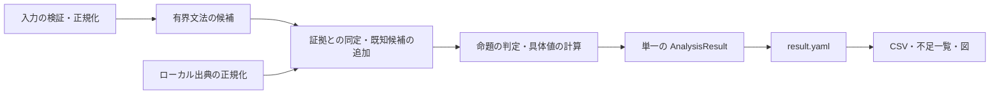

# 現行実装の責務

0.7.4の目的は、物理対象と必要条件を入力し、候補・根拠・数値の利用結果を調査することです。通常の入口はCLI `analyze`、内部の入口は `pipeline.analyze(Case, EvidenceCatalog)` です。同じ目的の入口は同じ処理と `AnalysisResult` を共有します。データベース固有の形式は入口で正規化し、出典を変えても同じ命題は同じ評価処理へ渡します。

## 依存方向

`case` が入力境界、`model` が候補型、`records` が出典付き科学データ、`units` が単位規則です。`generate` と `evidence` は独立し、`assessment` が両者の関係を評価します。`numeric` はデータの利用可否・選択・数値評価、`selection` は利用者の採用要求、`thermo` は熱化学式を担当します。`pipeline` は順序を組み立て、`Case.data_selection` を評価へ渡します。`export` が正規保存と読込みを担い、`needs` と `views` は保存結果を表示します。ネットワーク取得は `acquire` に閉じています。

YAML読込みは`yamlio`にまとめ、明示した重複キーを構築前に拒否します。既存のalias・mergeの明示上書き規則は維持します。LibYAMLがある環境ではsafe実装を使い、無い環境でも同じ検証を行います。数値形式の変換は`records.normalized_number`で行い、内部型では数値以外を受け付けません。形式不正と、数値として保存できるが科学的に不正な宣言を区別します。

## 決まることと決まらないこと

| 処理 | 決まること | 決まらないこと |
|---|---|---|
| 入力境界 | 型・単位・対応語彙、使う条件、明示上限 | 未入力の物理条件 |
| 候補生成 | 文法に従う組成・状態・反応式候補 | 実在性、構造、障壁、速度、全化学の網羅性 |
| 証拠同定 | 電荷・相・構造・状態・解像度の対応と競合 | 曖昧さを解消する無根拠の選択 |
| consistency | 保存則と宣言した過程の式パターン | 反応の実現、エネルギー散逸機構 |
| state | 名前付き命題の存在支持、または基底アニオンの電子束縛支持 | EAだけからの観測存在・寿命・他崩壊経路への安定性、解像度の採用方針 |
| 状態のthermochemistry | 競合していない審査された形成量または有効なNASA表現が少なくとも一つある | 指定温度の利用可否、利用者の採用要求、存在、反応障壁 |
| 反応のthermochemistry | 資格ある値と比較可能なエネルギー関係の整合。計算値は判定と別に返す | 値があるだけの実現性、EEDF、反応障壁 |
| reaction_evidence | 当該product-resolvedチャネルの根拠 | total過程の分岐、機構全体の完成 |
| kinetics / data_use | 全データの妥当性・適用性、採用可能な具体値・不足 | 未実装の積分、分布・flux・時間発展 |
| 数値の出典選択 | 適格な記録から明示要求に合う採用候補 | 記録の科学的承認、同定不足・適用条件不足の解消 |
| 図の経路 | 明示供給からのAND型候補到達性 | 時間順序、支配反応、観測可能性 |

各層の否定は、その命題についての否定です。不正な速度データを現象の不存在へ読み替えません。無関係な励起準位の追加で別の状態の存在判定は変わりません。lumpedとresolvedの重複はmembershipを根拠に記述し、存在判定や自動選択と混ぜません。状態を移すquenching等で別の非基底準位・電子項が終状態になる場合は、現行のground終状態template外としてconsistencyをunknownにします。保存則や相・構造の不一致は別に検出し、式形から準位のエネルギー順序を推測しません。

現行の状態と反応の`thermochemistry`は上表のように異なる命題です。状態側は温度入力を取らず、表現有無のpassから指定温度のH/G計算を保証しません。`Assessment.proposition` は `thermochemical_representation_availability` と、反応の `ionization_threshold_lower_bound` 等のエネルギー関係を区別します。状態の `state` も存在根拠とEAからの基底アニオン束縛の命題を区別します。全判定に新しい必須契約を課すものではありません。

反応の `delta_h_eV` は共通の明示参照条件にある形成量の差です。`Property.formation_reference` が参照温度、標準元素基準、標準圧力、イオンを含む有限温度で必要な電子規約・電子形成量を保持します。不足・不一致はこのΔHだけを抑止し、他の独立量を抑止しません。`delta_h_reference_temperature_K` と `delta_h_standard_pressure_Pa` を併記し、NASAの標準G計算温度 `temperature_K` と区別します。形成ΔHから出現閾値・障壁・発生を決めません。反応threshold・deltaEは `energy_properties` の独立Propertyに保持し、値の読取getter以外のscalarを内部に二重管理しません。旧外部scalarは読込みadapterで一度だけ正規化し、原宣言を保全します。明示した量の資格をチャネルのtierから昇格させません。

EAからの電子束縛は一つの共通処理を状態と付着で使います。正のEA範囲と電子非束縛宣言の矛盾は未確定とし、そのEAだけを数値利用から除外します。`unstable/transient`は電子非束縛の語彙ではありません。短寿命の存在宣言だけでは束縛や不存在を決めず、独立した存在根拠・EAを保持します。

`consistency`はfamilyから適用する式patternを選びます。電子衝突の解離と、電子を含まない単分子解離を区別し、中性・イオンの2粒子→1粒子会合には保存則と式形だけを確認します。未対応の誘起機構・高分子数会合は`unknown`、保存則違反や定義済みpatternとの矛盾は`fail`です。式形の`pass`から素反応、発生条件、速度次数、会合の安定化、解離の励起起源・エネルギー配分を決めません。これらの不足は数値データや熱化学の責務で保持します。

## 判定の意味と不足の保存

利用者へ返す全判定は `Assessment.proposition` と個別の `scope` を持ちます。存在支持、電子束縛、表現の有無、式形、エネルギー関係、根拠支持、係数利用を区別します。反応の `participant_state_support` は各参加状態の名前付き命題の集約で、`dependencies` が保存された状態の判定を指します。EAによる電子束縛のpassは付着側でも同じ結論で、安定化・速度・発生を追加の成立条件にしません。

`Requirement` は未確定の結論を決めるための対象・量・作業・理由です。情報の利用可否を確認した処理が返し、入力、出典情報、資料審査、同定、モデル未対応を区別します。全関数へ契約を付ける型ではありません。数値利用の不足は既存DataUseを正とし、kineticsへ同じ要件を複写しません。汎用の反応発生命題が未実装ならモデル未対応として返し、計算できたΔH/Gを消したり、資料欠測へ読み替えたりしません。

`Property.definition` は量ごとの意味を保持します。現在のIE/EA利用には対応するgas・ground対象とatomicまたはadiabaticの定義が必要で、同定された単原子groundの旧値もその対象の範囲で扱います。vertical値や定義不明な分子値は原資料へ残し、groundエネルギー比較へ流用しません。原子取得はその量のatomic定義を保存します。出典形式だけで定義を補いません。背景は[NIST gas-phase ion thermochemistry](https://webbook.nist.gov/chemistry/ion/)、不確かさの解釈は[NIST TN 1297](https://www.nist.gov/pml/nist-technical-note-1297/nist-tn-1297-7-reporting-uncertainty)を参照してください。

CSV・CLI・HTML・needsは保存された命題・値・条件・不足から導き、英文messageを解析して科学的に再判定しません。具体的な必要情報は対象・量・責務でまとめ、明示参照から派生した同じ作業を重複計数しません。各対象と理由・影響先は詳細に保持し、分類の一致を原因の一致と扱いません。

## 生成と同定

`EvidenceCatalog`は変更不能な証拠snapshotです。入力記録を独立して保持し、公開取得・照合で返す記録も独立したコピーにします。取得記録の辞書を編集しても元の索引は変わりません。更新は新しいcatalogの構築・読込み、または`dataclasses.replace`で行い、索引と実際の記録内容のfingerprintを再構築します。fingerprintは正規科学内容・数値記録・材料と読込み元のファイル内容を含み、手動構築した異なる証拠も区別します。評価時のasset完全性確認とは別の責務です。

生成資格は組成規則と明示した入力範囲で決め、feed/fragment/rearranged等の履歴で物理性質を決めません。状態・反応が増えなくなるまで規則を再適用します。pairの両側解離と、既存テンプレートの自己衝突を調べます。新しいpooling等の機構を推測で追加しません。上限に達した場合はclosureとは報告しません。

入力種の励起とion ligand-transferの相手は入力ground-state種という文法範囲を持ちます。neutral abstractionは別の組成規則で相手を決めます。既知状態や反応を証拠から追加した後に、機械生成をもう一度自動で閉包しません。`completion.mechanical` と `completion.attested` を別に記録し、総候補上限は証拠追加にも適用します。

候補IDは組成、電荷、状態ラベルと、必要な相・構造・種別・解像度を区別します。多価電荷は `Ar^2+`、二原子の一価電荷は `Ar2+` です。構造・相が不足したレコードは同一化しません。NASAの気相値を固相や同式の別構造から選びません。

EA、IE、電荷交換が必要とする対応基底状態は、組成、電荷、相、構造と基底状態の一致に加えて一意性を要求します。電荷交換の生成物もこの対応を確認します。elasticの内部エネルギー差ゼロは、左右の物理対象が同一の場合だけ返します。過程名や候補の挿入順からエネルギー関係を補いません。

式では第三体と壁を明示し、直接付着・再結合の安定化が不明なら `stabilization=unspecified` と記録します。原子・電荷が保存される式から光子や壁へのエネルギー収支まで成立したとは判断しません。

## 数値と根拠

単位、対象、適用域、出典資格、ファイルの保存実測hashと作者の宣言hashを保持します。数値表は、保存実測hashと宣言hashを照合した同じbytesから解析・計算します。再読込みで保存hashを現在値へ置換せず、読込み後のfile変更でも旧資格のまま新値を使いません。採用コピーも保存したbytesを検証し、宣言hash不一致の原記録を保全しても計算資格を与えません。Property、存在根拠、反応レコード、数値datasetを相互に自動昇格しません。overlayのnullは有効な値を遮らず、負の宣言や競合は消しません。

`SourceRef` はprovider、collection、release、原record ID、citation、URL等の明示された出典識別子を持ちます。`method` は measured / evaluated / calculated / estimated / unknown、`tier` は数値や存在根拠の資格、`review_scope` は宣言された審査対象です。取得先名から方法や資格を推定しません。`source_declaration` には入口の原宣言・補足を保全します。

明示した `review_scope` は、存在宣言では `state_existence`、各Propertyではその物性名、NASAでは `thermochemical_model` の資格を制限します。反応記録は `channel_assertion`、`threshold_eV`、`delta_e_eV` をそれぞれ確認します。scopeは承認を与える命題、statusは科学宣言自体の受理・拒否状態です。資格を持つtierでもscope外の命題と `status: rejected/conflicting` の宣言は採用しません。親科学記録が拒否・競合状態なら、その中のProperty・NASAも利用せず、個別量の審査で記録全体を復活させません。存在根拠の審査から別のProperty・NASAを承認しません。

Propertyの `qualifier` は非束縛等の科学的な宣言であり、管理上のstatusと区別します。部分的に否定・未確定の存在主張と、利用可能な物性を別資格で保持する場合は独立記録へ分けます。宣言の拒否を物理現象の不存在へ読み替えません。

空または省略scopeを持つ従来記録は、各型の既存資格を互換として維持します。数値宣言を持つsnapshotのscope省略時は、その数値量へ正規化し、係数の審査からチャネルやthresholdを承認しません。scope外の存在主張は競合を作らず、同一反応record IDの競合は審査された各主張の投影で比較します。

同一対象の存在主張が相反しても、物理照合はexactを保持し、存在命題だけをunknownにします。独立した物性・NASAは自身の資格と条件で評価します。threshold/deltaEの競合・不正値も量ごとに除外し、イオン化下限はthreshold、電荷移動の比較はdeltaE、elasticの内部エネルギー整合は両量の競合を確認します。Penningの励起量/IEと付着のEAは独立に評価し、除外量を既存messageへ残します。真の同定曖昧、拒否された宣言、必要量の競合による利用停止は維持します。

数値datasetも明示scopeがあれば、その `kind` が審査範囲に含まれる場合だけ数値資格を使用します。チャネルだけの審査で速度係数を承認せず、速度係数だけの審査で閾値を承認しません。

独立した状態科学記録は、overlayの `state_records` とRegistry種ファイルの `records` に保存します。対象IDと科学record IDを分け、同一対象の物性・NASA・存在宣言を出典ごとに保持します。物性の競合はその量の選択を未確定にし、無関係なNASAや状態同定を失わせません。NASA表現の同等性は係数・温度域・相・標準圧力で比べ、出典名の違いだけで競合にしません。元記録は保存します。

数値の明示 `id` は全体で一意な正規IDです。正規IDを省略した場合、原資料の `record_id` はprovider・collection・release・source_idの名前空間で区別します。同じ原記録の内容変更は同IDの競合として検出します。原記録IDもなければ科学宣言と正規出典情報からcontent IDを生成します。同じ検証済みbytesの保存場所だけは科学内容比較から分け、原参照path・原宣言・各取得来歴は保全します。bytesが検証できない参照の同一性を推測しません。

新しい状態snapshotの `record_id` または `source.record_id` も同じ名前空間で識別します。原IDがなければ科学宣言と出典から `local-state` IDを生成します。保存済みoverlay・Registryの `record_id` は正規IDとして保持し、旧IDを再生成しません。同じ原IDと出典を持つ旧記録に追加する場合も、既存IDを維持します。

同じ科学状態IDを異なる物理対象へ、同じ科学反応IDを異なる反応式へ割り当てた入力は、読込み・複数出典の統合時に形式不整合として拒否します。ingest/adoptの同ID比較も保存先全体で行い、対象ごとの配列へ移して衝突を避けることはできません。同じ対象での量の不一致は証拠として保持し、対応する判定で扱います。

反応宣言は共通の `ReactionRecord` に正規化し、overlayの `reaction_records` とRegistry channelの `records` に保存します。対象となる反応IDと科学記録の `id` は別です。新規原IDからは `source-reaction`、原IDのない科学宣言からは `local-reaction`、明示したsnapshot `id` からは `reaction-record` IDを作り、保存済みIDは維持します。チャネル根拠、threshold、deltaE、審査範囲、方法、出典、原宣言が直接分析・ingest・adoptで同じ判定へ届きます。

純粋な反応主張には空のNumericDatasetを作りません。数値を併記したsnapshotは科学主張と数値記録を別の保存先へ置きます。独立した `reaction_records` / channel `records` の要素に `datasets` を埋め込む入力は拒否し、数値はoverlayの `datasets` / channelの `data.datasets` に置きます。反応energyは共通Propertyに量の定義・個別資格・出典・不確かさを保存して往復します。利用者によるProperty/NASAの選択と新しい物理モデルは別の拡張です。

励起エネルギーの数値資格は `properties.excitation_energy_eV` に置きます。状態側のscalar宣言は入口で同じ値へ照合し、元の品質・単位・出典を個別Propertyへ正規化します。存在根拠だけを追加してもエネルギーの品質は変わりません。Penningと形成エンタルピー導出はこの資格を参照します。イオン化下限は同じ物理対象に対応する宣言thresholdとIEを比較し、両側の有効な宣言区間で下限関係が定まらなければunknownです。差の整合は比較できる宣言区間の交差で評価します。未宣言の不確かさを誤差ゼロとせず、点としての名目比較はその範囲を明示します。誤差を絶対的な物理禁止や未取得の測定精度として扱いません。

IE、電子親和力、Penningの比較は共通のProperty区間を使います。等しい中心値でも宣言誤差が違えば全区間を保持し、noteだけの誤差をゼロとしません。EAは同じ相・構造の中性親と基底アニオンの束縛関係、Penningはresolvedな供与状態と対応する基底生成物のエネルギー関係に限ります。励起生成物、構造変更、lumped人口へ基底IE式を転用しません。[根拠と限界](scientific_data_review.md)に詳しく記録します。

全datasetを評価してから、`data_selection` の量別要求を適用します。不正・範囲外の優先データからは他の適格な記録へ進めます。適用条件が未入力の優先データは候補に残します。同IDの異なる科学宣言は上書きしません。同じ物理量・次元・速度次数で、適用領域が重なる値と不確かさを比較します。有限個の比較点は連続域全体の同等性の証明には使いません。

再取得日時や原本の保存先は科学的な値の違いではありません。状態・反応・数値の同ID比較と匿名IDの生成は、標準取得contextと一致する重複出典識別子を除いた共通の比較処理を使います。未知の物理条件・注記、方法、資格、値、assetの参照とhashは比較へ残します。原宣言を変更する処理ではなく、異なる取得宣言はoverlay・Registry・正規結果に併記し、完全に同じ宣言の再採用は既存記録を保持します。

`prefer` は指定したmethod、provider、collectionの順の軸で順位を比較し、各軸の未指定値は同順位の後順位とします。`only` は指定した軸の許可集合すべてを満たす記録へ制限し、記述順を優先順位にしません。`record` は数値dataset IDへ固定します。最上位の異なる値は競合で、同順位の記録を入力順で選びません。明示した別順位から採用しても、他の適格記録との不一致とID競合を `DataUse.disagreements` に残します。候補が同じ量として比較可能で不一致も不足もない場合だけ、品質、表現種別、安定IDで一つを返します。

異なる速度則が同時に適用でき、明示要求で一つに決まらなければ `rate_law_selection` を不足として返します。要求は `DataUse.selection` に保存し、数値の利用結果は `DataUse` 一つに置きます。物性・NASA・存在根拠への採用要求は未対応で入力拒否します。量別要求のない場合だけ旧dataset `preferred` を使う互換処理を残し、0.8で撤去します。

条件が未入力の別速度則は、不適用と決まっていないため選択前に捨てません。明示要求で選んだモデルにも、そのモデル自身の不足条件を残します。数値のみを追加したoverlayからreaction_evidenceを自動でpassにしません。

Arrheniusは `k=A(T/Tref)^b exp[-Ea/(kBT)]` とし、参照温度とパラメータ単位を要求します。化学量論次数と速度次数は別に扱い、実効速度には明示次数を要求します。電子温度と気体温度、KとeVを区別します。断面積は分布の範囲と積分が必要、stickingは0～1の確率でfluxへの変換が必要です。

気相基底状態のNASA7、共通の標準圧力、範囲内温度が揃う場合に限り、数密度形の `Kc=exp(-ΔG/RT)(p0/kBT)^Δν` を返します。電子・非熱平衡励起状態へこの平衡式を適用しません。式と条件の根拠は[Canteraの反応速度](https://cantera.org/stable/reference/kinetics/reaction-rates.html)、[種の熱力学](https://cantera.org/stable/reference/thermo/species-thermo.html)、[stickingの公式説明](https://doc.comsol.com/6.3/doc/com.comsol.help.plasma/plasma_ug_heavy_species.08.27.html)を参照してください。

一反応の熱化学値には、その反応の参加状態に対応する物性だけを選択します。無関係な全候補の物性を毎回再選択せず、計算に必要な範囲を限定します。物性の資格・競合規則や、返す判定・数値は変えません。

## 保存と変更

schema検査、有限値、IDと対象、反応参照、入力と供給状態、集計・完了範囲の整合を共通読込みで確認します。`result.yaml` は同じディレクトリの一時ファイルを検査してから単一replaceで公開します。その後にCSVを公開します。CSVが失敗した場合は正規結果の保存済みと補助表示の不足を区別し、記録hashで古い表を検出・再生成できます。

`ingest` は式照合・明示IDの双方で安定化宣言まで照合します。式だけでprocessが不明な宣言を、既存の型付きチャネルへ推測で割り当てずreview queueへ置きます。式を持たない明示 `reaction_id` 入力では保存結果の対象参照から物理対象を得て、元の入力宣言も保全します。宣言の無い記録をradiativeやthird-bodyの根拠にしません。`adopt` は対象とassetを全件検証し、変更ファイルをstageしてから置換します。同IDの科学内容変更は上書きせず、ingestはqueue、adoptは入力エラーで変更前を保持します。途中のI/O失敗は変更前へ復旧し、復旧にも失敗した場合は例外と復旧用backupを残します。複数ファイルの同時公開、停電や並行更新に対するatomic性は保証しません。

状態の読込み・照合・採用・導出は同じ正規物理キーを使います。併記された状態属性と個別Propertyは一記録単位で照合し、競合を片側だけ成功として処理しません。Registryとoverlayの独立した存在宣言も保持し、後の宣言で先の根拠を消しません。

同じRegistry反応pairを複数ファイルで宣言しても、全channelを保持します。channel IDの重複は同内容でもファイル・位置付きで拒否し、更新先を曖昧にしません。一つのchannelの `records` に独立出典を保持でき、同じ科学IDの取得宣言も併記できます。保存結果の数値選択は、入力要求、evidenceの採用記録、量、個別評価の値・不足と照合します。保存結果の読込みでは外部取得や科学判定の再実行を行いません。

旧pipeline、policy選択、累積screening、capability/readinessの二重管理は撤去しました。外部データ形式のadapterは維持します。schema4は通常実行から切り離した一回限りの移行工具だけが読み、旧判定を採用しません。今後の拡張原則は[AGENTS.md](../AGENTS.md)に置き、実装順や過去課題をここへ混ぜません。
