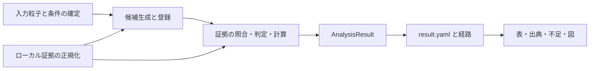

# 現行実装の責務

1.0は、気相P0・P1の反応候補を明示条件の下で調べる基盤です。通常の入口は `rgen analyze`、共通処理は `pipeline.analyze(Case, EvidenceCatalog)` です。入力例は[通常利用](../README.md)、反応種ごとの適用と物理式は[反応別対応表](reaction_judgment_matrix.md)、保存形式は[公開出力仕様](output_reference.md)に置きます。

## 依存方向

| 境界 | 所有する処理 | 渡すもの |
|---|---|---|
| `case`・`chemistry`・`structure` | 入力の正規化、粒子・供給・衝突相手と明示反応の同定、明示グラフの検証と編集 | 明示粒子・反応、条件、探索上限 |
| `generate`・`evidence` | 有限文法による候補、外部記録の正規化、候補集合への登録と出典の照合 | 反応式・参加状態、候補の由来、照合した記録 |
| `balance`・`assessment` | 元素・電荷・核種、宣言した過程、状態とチャネル、使用する物性の資格 | 独立した命題、適格な量と原記録 |
| `energy`・`screening`・`thermo` | 端点と準位差の算術、重心系への換算と必要条件、有限温度の熱化学計算 | 量・単位・条件・出典・不足、条件付きの結論 |
| `selection`・`numeric`・`outcomes` | 明示した採用方針、元の数値量と係数用途の評価、保存判定の投影 | 採用値または必要な作業、判定ラベル |
| `export`・`pathway`・`presentation`・`views`・`needs` | 保存と参照の整合、明示供給からの到達性、保存内容の表示 | 正規結果と用途別の投影 |

`model` は候補・判定・計算結果の型、`records` は出典付き科学記録、`units` は単位換算、`yamlio` は共通読込みを所有します。`reactgen` の通常分析はローカルで完結します。外部取得は `acquire` の明示操作に置きます。

## 入力・候補・証拠

- `case` は中性ガスの短縮指定と明示供給を同じ状態へ正規化します。`structure` は利用可能なRDKitで元素・電荷と明示SMILESを照合します。構造付き供給へ束縛した衝突相手は探索前に確定します。構造操作の未対応と、検出した構造・組成の矛盾は別に扱います。
- `generate` は候補状態・反応の登録と上限を管理します。機械生成と、必要粒子が登録された宣言チャネルを探索深さ順に処理します。全参加者が気相と同定された式の元素・電荷・明示核種に反証があれば、該当式は評価に残し、生成物を探索に渡しません。機械生成と外部追加の打切りを別に保存します。反応物・生成物の対応を持つ構造操作と、組成のみからの仮説を区別します。外部記録に書かれた状態を明示供給に追加しません。
- 状態数上限は新しい状態の登録に適用します。上限内の状態だけで完結する反応の審査と登録は、深さ・反応数・試行数の制約内で続きます。登録できなかった状態の先は探索せず、部分結果として保存します。
- `limits.expand_unresolved_states: false` は機械生成の入射粒子を、明示供給と組成仮説以外の `resolution: resolved` に絞ります。すでに登録した生成物、反応、資料の適用や経路判定は共通処理を使います。未解像の粒子からでも、登録した資料・明示式が解像済みの生成物を導入すれば、そこから機械探索を続けます。解像度は入力・候補の記述粒度であり、状態の存在支持は別の命題です。
- `evidence` は却下・競合中の記録を候補や状態の提案に使いません。独立に候補となった反応では原記録とその状態を参照できます。同じ候補への変換対応は資料順によらずまとめ、チャネル審査済みの対応があれば優先します。準位差の計算は、独立に式と照合できた対応を使い、有効な対応で異なる準位差が残れば未確定とします。
- `case.reactions` の式は共通の式パーサーと候補IDで正規化し、衝突相手と同じ規則で明示供給の別名を解決します。反応物が候補に揃い、元素・電荷・明示核種に反証がない式を同じ作業列に載せ、生成物を探索範囲内で展開します。同一の生成枝や資料由来の枝は元の変換対応を保持します。展開されなかった明示式も評価対象に含めます。生成物の探索への登録、入力供給、科学記録の資格、条件付き経路の到達性は別に扱います。
- 状態は組成・電荷・相・構造・準位と解像度を照合します。明示SMILESは検証したグラフの同一性で照合し、資料の元表記を保持します。構造付き粒子に既知の準位を接続する場合も、その準位と参照状態に対する資料の構造同定を使います。反応は化学量論に加え、過程・安定化と環境を照合します。対象の完全一致、条件付きの対応、関連資料を区別し、出典IDと物理対象を混同しません。同じ科学記録IDを異なる対象に割り当てる宣言は拒否します。同一対象への独立した異値・異なる出典は証拠に残します。
- 原反応項の形式は合算前に検証します。元の十進係数から正味差・収支を計算し、微小な別種の寄与を許容差で消しません。`balance` は明示核種の矛盾と核種不明を区別します。`structure` は原子対応と結合・電荷の変更を同じグラフ操作で再生して確認します。[反応別の適用範囲](reaction_judgment_matrix.md)

## 科学判断の境界

| 判定・計算 | 扱う命題 |
|---|---|
| `conservation` | 明示した反応式の元素・電荷・核種収支 |
| `consistency` | 状態では式・電荷と明示SMILESの検証。反応では保存則と宣言した過程の式形・変換対応、昇降を宣言した準位移行では符号付き準位差を参照 |
| `state` と `electron_binding` | 対象状態の存在支持と、一価基底アニオンの電子束縛。反応側は保存済みの参加状態判定を参照 |
| `thermochemistry` | 状態側は適格な熱化学表現の有無。反応側は適用できる宣言エネルギー比較 |
| `thermochemical_calculations` | 端点差・各粒子の準位差、衝突条件との差、独立した形成量差・標準ΔG・数密度形Kなど |
| `energy` | 同定した端点と指定条件での名目エネルギー必要条件 |
| `reaction_evidence` | 生成物を区別した当該チャネルを支持する証拠 |
| `DatasetAssessment`、`data_use`、`kinetics` | 元の数値量の適用、係数としての採用と不足、その用途結果の判定 |

保存則の成立、変換の式形、指定条件での適合、観測による支持はそれぞれ独立です。正味式だけで励起起源、会合の安定化、速度次数、反応障壁、エネルギー分配や分岐を決めません。状態の存在支持から電子束縛を補わず、未確認の状態や値は依存する命題だけに反映します。

元素・電荷・核種の収支に反証がある式では、その式に依存する反応熱・平衡定数・衝突エネルギー・係数利用を対象外とします。元の科学記録と数値表の評価は証拠として残します。

電子衝突の分裂過程は、親・断片の電荷と出射電子数から生成と判定で共通に分類します。重粒子による脱離は親を保持する式と分裂する式を区別します。ペニング電離の宣言は供与体と終状態の対応、準位の下降を確認し、全反応のエネルギー収支は独立して評価します。[反応別の適用範囲](reaction_judgment_matrix.md)

`assessment` は対象・定義・審査範囲・条件を満たす記録と物性の組を計算まで維持します。出典指定で資格を補いません。`energy` は同じ参照を持つ端点の差を計算し、適格な隣接電荷段の差を符号付きで合成します。同じ基底状態に還元されて相殺する項は、その先の電離エネルギーを要求しません。`screening` は式の入射二粒子に対応する衝突条件を選び、重心系の必要条件を評価します。ペニング電離の宣言比較も同じ条件選択と換算を使います。断熱IE／EA、反応閾値、appearance energy、有限温度のPA／GBは、定義と対象に対応する用途で使います。[計算式と境界](reaction_judgment_matrix.md#共通の計算判定と表の読み方)

同じ気相端点の符号制約は、直接の端点差と形成量などから求めた差に共通です。対応が確定した中性・正イオンの基底電荷段では、電荷を上げる側が正の差を必要とします。対応する基底と励起準位でもエネルギーの順序を確認します。矛盾する値は出典確認に残し、独立した適格な値があれば利用します。端点を埋める記録が未審査・定義不足・対象不一致の場合は、資格評価の理由を使って必要作業を示します。

端点差と基底負イオンの電子束縛は、必要な基底状態や隣接電荷段を候補集合の外でも同じ資料照合・選択規則で参照します。計算や判定に使った候補外の出典は正規結果に保存します。その基底参照を探索候補や経路の供給へ追加する処理はありません。

数値の表現・適用域・原記録の評価は `numeric` が担います。元曲線の利用可否と、分布で平均した反応係数は別です。単一の衝突エネルギーを与えても曲線から暗黙に点を選びません。速度則やobservableが異なる記録は、出典順だけで一つにまとめません。[記録形式と語彙](registry_data_guide.md)・[数値の採用要求](output_reference.md#数値の採用要求)

## 正規結果・経路・表示

`export` は結果を正規投影し、形式、有限値、IDと参照、入力・供給、判定の投影、保存された経路の整合を検証します。`result.yaml` を検証済みの一時ファイルから公開し、補助CSVは保存したハッシュを使って照合・再生成できます。計算入力は対象・量・原記録IDと個々の科学宣言を識別する参照を保持します。参照の照合を保存検証と表示で共有し、原記録IDを共有する別出典の採用値と代替値も辿れます。

`screening` は入射粒子に照合した条件を衝突余裕の計算入力として保持します。端点差やエネルギー交換モデルが不足する場合も、照合済みの入射条件と独立に求められた重心系の値を残します。`reaction_tables` が保存値から入射条件と数値を取り出し、CSV、SVG、HTMLで同じ投影を使います。

`dnt` は正規結果から気相イオン・中性粒子対を抽出し、保存した式・判定・物性宣言を後段の計算用に整えます。換算質量と双極子によるモデル候補を出力し、相互作用モデルの適用判断や断面積の計算は外部実装に置きます。[DNT向け出力](output_reference.md#dnt向けの出力)

`pathway` は全反応物を必要とするAND到達性、全生成案、最小深さの代表を算出します。`candidate` は保存則の反証、`conditioned` はさらに過程の反証と指定条件でのエネルギー反証を適用します。`--checked` は構造検証の未確定や状態の存在・束縛に対する反証も除外根拠にします。端点差の計算で相殺する粒子も経路の参加状態です。`--via` で指定した生成枝は、その生成物を前提にせずに全反応物へ到達できるかを照会します。HTMLとPNGは同じ照会結果を表示します。[経路の公開仕様](output_reference.md#形式7以降の計算と経路)

科学判定と数値評価が対象、命題、範囲、結論、理由、必要作業を決めます。`outcomes` は保存時のラベル生成と再読込み時の整合確認に同じ投影を使い、集計の分母を命題・計算ごとの適用対象から導きます。`needs` は保存済みのラベル・必要作業・依存先を使い、所見と補完作業をまとめます。入力不正や参照矛盾は入出力境界で検出し、科学的な未確定や追加調査とは区別します。

端末の概要は入力、候補数、主要な保存結論、次に開く表示に絞ります。`reaction_tables` は状態・反応の一覧と、対象・命題・結論・理由・必要作業を持つ判定別の表を作ります。絞り込みは保存された衝突区分・過程・各判定の論理積です。`records` は記録単位の元量評価と反応単位の係数用途を分け、採用IDは保存済み選択から投影します。

`presentation.diagram_terms` は図の各辺に表示する量論と第三体を共通化します。`reaction_graphs` はエネルギー余裕、判定の分布、単一反応を独立したSVGにします。経路PNGとネットワークHTMLの経路図は、照会で選ばれた反応の両側を描き、保存された支持関係で中間種をつなぎます。HTMLでは代替、周辺の枝、判定理由と出典も個別に閲覧できます。反応一覧の絞り込みは経路照会の枝の採否に作用しません。

## データを変更する境界

`acquire` は原本・変換結果・取得情報を保存し、`ingest` は正規候補への照合結果と未解決の作業をoverlay・queueへ置きます。`adopt` は明示実行時にRegistryを更新します。単一書込みを前提に、対象・参照を事前検証し、通常のI/O失敗時は変更前へ復旧します。読込み・照合で科学的な資格を自動で変更しません。[取得・照合・採用](data_sources.md)・[出典と配布条件](source_license_policy.md)

## 拡張の境界

必要な反応経路が特定できたときに、対象と参照が合う準位、断熱IE／EA、D₀、形成量等を追加します。新しいモデルは、既存の計算で扱えない物理的な前提と出力を先に定めます。単分子・表面の扱いは[範囲境界](reaction_judgment_matrix.md#範囲を別判断するもの)を参照してください。変更時に確認すべき責務、反例、置換した処理の整理は[開発指針](../AGENTS.md)に置きます。
