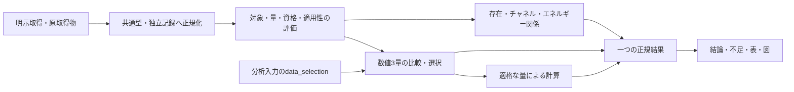

# 出典・データ選択基盤の到達点と継続計画

2026-10-12更新。対象：0.7.4 / schema 5。共通出典・独立科学記録・数値3量の選択に続き、asset完全性、状態同定と存在競合、反応エネルギー競合の作用範囲、EAの矛盾処理、形成量の共通参照型と比較前提、量の定義・反応エネルギーの独立Property・判定の具体的不足を実装しました。本書は到達点と残る設計課題を分けます。実装済み形式の詳細は[現行責務](core_design.md)、[公開出力](output_reference.md)、[Registry形式](registry_data_guide.md)、[取得案内](data_sources.md)、今後の順序は[残件計画](remaining_work_plan.md)を参照してください。

## 基盤の目的と現在の範囲

同じ物理対象・量・命題・使用条件には、DBによらない正規入力と同じ意味の出力を使います。外部の欄・語彙・単位はadapterで解釈し、情報不足は共通評価で返します。別DBの値・方法・適用条件が違えば結果は変わりますが、出典文字列や無関係な相の追加だけで物理的結論を変えません。

データベース名、保管場所、取得方法、科学的方法、個別審査、物理的適用性、分析時の選択は別の情報です。利用者の優先指定は採用方針であり、欠けた物理条件・科学資格・生成物分岐を生成しません。情報や責務を区別するために、それぞれ専用の型・module・診断層を新設する必要はありません。既存の型と処理を優先し、現在行う判断に不足する情報だけを追加します。



図のdata_selectionは現在、rate_coefficient・cross_section・sticking_coefficientだけです。Property・Thermoや存在/反応根拠の選択指定は未対応で明示エラーになります。curve/probabilityの用途を追加する図ではなく、選択できるdatasetの種類を示しています。

## 修復済みの境界と残る課題

| 境界 | 実装済みのこと | 残る課題 |
|---|---|---|
| 反応の物理対象 | 電荷交換の対応基底状態を組成・電荷・相・構造・唯一性で探索。elasticの同一性を式から確認 | 全processの物理モデルや未知の誘起機構を確定したわけではない |
| 複数チャネル | 同PairKeyの別ファイルから全チャネルを保持。重複IDは同内容でも位置付きエラー | 入力側は独立記録に一意なIDを与える。ファイル名を優先規則に使わない |
| 存在と物性 | 存在主張の競合は存在命題へ限定し、同一対象のexact照合と独立量を保持。unknown記録でEAの束縛推論を隠さない | EA束縛は全分解経路の安定性・観測存在・寿命ではない。存在不明の機構を量の利用成功で承認しない |
| 熱化学 | 物性・反応エネルギー量の競合を依存する命題へ限定。NASAの係数・温度範囲・相・基準圧を比較。形成量は共通温度・標準元素基準・標準圧と必要な電子規約/電子形成量を検査。反応エネルギー各量の定義・独立資格・根拠・誤差を共通Propertyへ保存 | 旧形成量の元資料・参照条件、利用者のProperty/NASA選択、数値datasetの複合条件と新モデル条件は残る |
| 科学記録の保存 | 状態はstate_records / species.records、反応はreaction_records / channels[].recordsで独立保存。反応threshold/deltaEもenergy_propertiesへ量ごとに保存。共通原ID生成・科学内容比較と、原宣言を保持する再取得併記を実装 | confidence・相関の統計利用や未対応の物理モデルに必要な条件は、その量・モデルの用途に応じて追加する。旧値へ未確認の情報を補わない |
| 各主張の資格 | 状態存在、各Property量、熱化学モデル、チャネル、閾値、エネルギー差へ明示review_scopeを適用。数値だけの審査を別主張へ広げず、拒否された宣言を使わない | 無scope旧宣言は既存資格の互換範囲。独立量の参照条件・根拠は必要量から整える |
| assetの保存・比較 | 作者の宣言hashと保存実測hashを保持し、実際に解析・採用するbytesを照合。同じ検証bytesの保存場所だけを科学比較から分離 | 未観測・不一致bytesは利用しない。元宣言の保全は科学的な承認ではない |
| 入力・正規結果 | CLI/APIが同じCase.data_selectionを使う。選択要求・不一致をDataUseに保存し、採用対象・方針の整合を再読込みでも検査 | Property/Thermo、判定の根拠範囲は今後の拡張。数値採用と証拠支持を同義にしない |
| 取得・台帳 | ASD注記、RATE12/22、LXCat未宣言scope/observable、PyroMatのh(T)を修復。chemicals熱化学は選択tableとpackage版・原IDを保存。source_catalog一本へ取得先・提供量・converterを整理 | 旧chemicals記録と他adapterの実際のmethod・元測定情報、ASD導出概要の責務分離、UMIST加算モデルは残る |

監査時の`build/judgment_boundary_audit.py`と同json、`build/remaining_plan_status_2026-10-12.json`は実装前の履歴です。旧不具合を期待するassertionを含み、現行の回帰検証として実行しません。相・構造・順序、同pair、量間競合、同値NASA別source、unknown記録、数値とチャネルの独立性は対応するtestsで確認します。synthetic fixtureは検証用で、Registryへ科学値として追加していません。

## 判定に必要なデータと、決まらないこと

以下は利用者に意味のある責務と、科学的に必要な情報です。全欄を利用者へ手入力させたり、各行ごとに新module・boolean・契約を追加したりする設計ではありません。対象・条件は利用者入力、値・元条件・方法・出典は科学記録から得ます。未対応の条件・量は実装済みと扱いません。

| 処理・命題 | DBによらない必要入力 | 返す出力・決まること | 決まらないこと |
|---|---|---|---|
| 候補生成 | 入力対象、文法・生成上限 | 候補、生成範囲、打切り | 実在、発生、全化学の網羅 |
| 物理対象の同定 | 組成・電荷・相・構造・状態/準位・解像度、recordの対象 | 同一・関連・曖昧・対応なし | 値の品質、存在、今回の数値採用 |
| 明示存在根拠 | 同定状態、存在/非束縛等の主張、その審査と根拠 | 指定状態の支持・否定・未確定 | 人口、寿命、反応性 |
| 基底陰イオンの電子束縛 | 対応する中性/陰イオン、EAの量・基準・範囲・資格 | 電子脱離に関する束縛推論 | 観測存在、全分解経路の安定性 |
| 保存則・process整合 | 組成・電荷、左右係数、電子/第三体/表面、process定義 | 宣言式の整合・不整合・未対応 | 観測、速度、安定化。通常DBは不要 |
| 各量の使用評価 | 対象・用途・単位・基準、値/表/fit、個別資格、適用条件と使用条件 | 記録ごとの適用・範囲外・不正・未審査・不足 | 別量・別命題の承認。不明条件は不適用ではない |
| 数値の選択 | 各記録の評価、同じ量の比較、分析要求 | 採用記録、方針、残る不一致・不足 | 同定・存在・チャネル承認、データ品質の昇格 |
| エネルギー関係 | 関係の命題、対応状態のIE/EA/準位/閾値、基準・不確かさ、必要な衝突条件 | 関係の成立・不成立・未確定 | 発生、遷移確率、速度 |
| 種の熱化学値 | 同定対象、適格なモデル/宣言値、温度・参照状態・範囲 | 指定条件のH/S等と単位、入力record | 種の存在、他温度、全物性の承認 |
| 反応の熱化学値 | 正規反応、参加状態の必要量、共通の温度・基準・標準状態 | 計算可能なΔH・標準ΔG・対応するK | 障壁、速度、非平衡の方向・人口。HfだけからS/Gを補わない |
| チャネル根拠 | 反応物理キー、process、生成物状態、安定化、チャネル主張と審査 | 当該チャネルの支持・矛盾・不足 | totalからの状態別分岐、数値reviewからの存在承認、機構完成 |
| 速度係数 | チャネル・次数、同じ量の速度則、Tg/Te等、出典条件、採用方針 | 指定条件のkと単位、record・不足 | 反応量、時間発展。密度と境界は別入力 |
| 断面積/確率の参照・評価（用途拡張） | 過程・observable・エネルギー軸・曲線、または材料/表面/入射条件・確率モデル | 曲線/指定点の断面積、指定条件の確率 | 分布積分したk、表面flux |
| 分布積分/flux変換（未実装） | 適格データと明示分布・規格化・積分域、または入射flux/幾何条件 | 指定モデルの係数・flux・源項 | EEDF自体、機構完成、予測精度 |
| 表・不足・保存 | 一つの正規結果 | 同じ対象・命題・値・条件の表示と保存 | 表示順による再判定 |

### 熱化学の命題と計算を分ける

状態のthermochemistryは`thermochemical_representation_availability`、つまり審査された形成量またはNASA表現を持つかという結論です。指定温度での利用可否や種の存在は示しません。反応のthermochemistryには`elastic_internal_energy_identity`、`ionization_threshold_lower_bound`、`penning_energy_requirement`、`charge_transfer_energy_defect_consistency`等のpropositionを付け、どの関係を判定したかを保存します。ΔH・ΔG・Kは計算値であり、値が求まったことを反応発生のpassへ変換しません。

形成量はPropertyの`formation_reference`へ参照温度、`standard_elements`の元素基準、標準圧、必要な電子規約・電子形成量を正規化します。ΔHは全参加状態の共通参照を検査して計算し、`delta_h_reference_temperature_K`と`delta_h_standard_pressure_Pa`を併記します。利用者の気体温度を参照温度へ無言で転用しません。欠落・不一致はΔHだけを未確定にし、NASAのΔG/Kや独立したエネルギー関係を維持します。0 K/有限温度、異なる参照温度・電子規約を自動補正するモデルは未実装です。旧Registryの条件確認は科学データ整備として残ります。[形成量の現行形式](registry_data_guide.md#形成エンタルピーの参照)と[根拠・検証](scientific_data_review.md#形成量の共通参照と電子熱化学規約)を参照してください。

NASA7のH/S/Cp計算では、対象・温度範囲・相・基準圧を扱います。NASA9・ShomateをNASA7へ読み替えません。モデルを増やす場合は同じ物理量を返す正しい評価式と基準を設計します。[Canteraの公式モデル仕様](https://cantera.org/stable/reference/thermo/species-thermo.html)を既存の科学仕様の参照先とします。平衡計算のKは指定標準状態・モデル内の量で、混合組成を入力しない現行計算から実際の平衡組成や非平衡の方向は決まりません。

### adapter、評価、計算の境界

adapterは外部の記号・欄・単位と元の主張を正規型へ渡します。同定、量の使用評価、選択、物理関係は共通処理が担います。provider名を見て不足を補う科学的分岐を追加しません。ASDのJ成分集約・保持したE1経路の概要は取得側に残っており、原準位解釈と導出処理の分離が継続課題です。掲載E1情報は全寿命を決めません。

直接snapshotとingest/adoptで、同じ科学主張を同じ正規型へ渡します。状態・反応・数値の来歴と原宣言を往復し、反応根拠・閾値・エネルギー差も独立反応記録として評価へ供給します。純粋な反応主張には空の数値datasetを作らず、明示数値だけを別の量集合へ保存します。反応過程が未同定の宣言は特定過程へ無言で合わせず、確認待ちとして返します。

## 出典情報・方法・審査の管理

| 軸 | 現在保持する内容 | 継続して必要な情報 |
|---|---|---|
| 出典参照 | SourceRefのprovider、collection、release、record_id、citation、url、source_id、source_type | 元資料・転載関係の明示。欠けたID/版をsource文字列から推測しない |
| 科学的方法 | measured / evaluated / calculated / estimated / unknown。表/fit等の表現と別 | 上流測定/理論の構成、具体method、モデルと元record参照。evaluatedだけから測定のみとは判断しない |
| 個別資格 | 既存tierと明示review_scope、元のstatus・審査宣言。反応主張はreviewed_forで対応scopeへ限定 | 反応エネルギーの独立した量型・出典・tier・誤差の充足。個別資格を同providerの別量へ広げない |
| 原宣言 | source_declarationに原欄・注記・出典・snapshot sourceを保持 | 必要な条件・基準を科学型へ昇格する際の明示decoder |
| 取得完全性 | snapshot 1、元ローカルfileのraw copy/hash、HTTP取得manifest、ASD原応答 | 利用する取得経路のquery/版・利用条件・応答の必要情報を保存する。全DBのmetadata充足を先行条件にせず、不明情報は不明として依存する結論だけを止める |
| 導出 | 元注記・入力・model情報を宣言に保持できる | 必要な派生値の入力record、式・版・適用範囲を比較/再評価可能にする |

方法をsource_typeの文字列から推測する処理を止めました。既存tier/statusは境界adapterとして受理しますが、方法と審査を同義にしません。SourceRefは全情報を押し込むpayloadではなく、小さな出典参照です。未知の原欄はsource_declarationへ保持します。

ReactionRecordの明示review_scopeはchannel_assertion、threshold_eV、delta_e_eV等の該当主張だけを資格付けします。数値snapshotでform・parameters・asset・data・value・unit等を宣言した記録の無scopeは、そのdataset.kindへ限定します。独立channelの無scope旧宣言は既存資格の互換範囲で、数値の掲載をchannelやenergyの審査へ読み替えません。これは各量に独立した出典・tier・誤差を持たせた完成形式ではありません。

StateRecordの存在にはstate_existence、Propertyには各量名、NASAにはthermochemical_modelのscopeを使います。空scopeだけを旧無指定資格として扱い、不正なfalsey値をそこへ読み替えません。存在審査から自動生成した励起scalarにも親scope/statusを引き継ぎ、数値審査へ昇格させません。statusのrejected/conflictingは当該科学宣言の利用停止で、物理現象の否定ではありません。

同じ原測定が別DB・転載表・社内fileに現れても独立観測として自動加算・平均しません。同じ値でも同一測定とは限らず、不確かさ内の一致も科学的同一性ではありません。相関・信頼水準が不明なら自動重み付けを行いません。

## 内部形式と明示操作

| 形式・操作 | 現行の責務 | 互換・制約 |
|---|---|---|
| source_catalog.yaml / acquire sources | 提供量・取得方法・実装converter・公式参照・権利確認先を一つに案内 | schema 3。登録は承認/許諾/優先を与えず、利用者providerの登録を必須にしない |
| acquire fetch | 台帳のfile URLへ明示アクセスし、要求/最終URL・UTC日時・full SHA256・形式をacquisition.yamlへ保存 | 全DBのAPI adapterではない。旧custom catalogは境界で受理 |
| snapshot.yaml | snapshot_version: 1、records、source。local converterは対応入力をraw/へ保存 | 版なしはlegacy入力。未知versionは拒否。取得・変換でreviewを追加しない |
| ingest | 対象照合、原宣言・資格・出典を保持したoverlayと未対応queueを作成 | 形式受理・照合は科学的承認ではない |
| overlay state_records | canonical state IDごとの独立StateRecord list。property/NASA/存在宣言とrecord_idを保持 | 旧properties/thermo/states mappingは読込み境界で正規化。新出力で単一値へ重複保存しない |
| overlay reaction_records | canonical reaction IDごとの独立ReactionRecord list。反応根拠・閾値・エネルギー差と各記録の資格を保持 | 数値はdatasetsへ置く。対象・過程が異なる宣言とembedded datasetsは拒否する |
| Registry species records | 対象の既存定義を保ち、独立科学recordを追加 | adoptは値の使用方針を永久preferredへ書き戻さず、同ID異内容を消さない |
| Registry channel records | 既存チャネルを変更せず、独立反応宣言を追加 | 保存containerの選択は科学的な優先ではない。従来の単一channel宣言は境界adapterで保持 |
| 分析入力 | 物理conditionsと別のdata_selection | 今回は数値3量。通常利用に選択を必須としない |
| result.yaml | 候補・証拠・判定・値・選択・不一致・不足の正規結果 | schema 5にproposition、selection、disagreementsを任意項目として追加。旧schema 5結果も読込対象 |

数値記録の明示idは既存の正規IDとして保ち、原資料のrecord_idはprovider・collection・release等と組み合わせます。匿名数値の内容IDと重複比較では、科学条件を保持し、標準取得文脈の時刻・URL・保存場所だけで別科学記録や競合にしません。再取得の各原宣言は保存します。

新規snapshotの状態原IDはトップrecord_idまたはSourceRef.record_idから読み、数値・反応と同じ名前空間規則で科学記録IDを作ります。匿名IDは原科学宣言と出典文脈から作り、標準取得文脈を除きます。審査範囲の順序だけの違いは集合として比較します。未知の科学条件・配列の意味まで同一化しません。

保存済みoverlay・RegistryのIDは読込み境界で保持します。原IDを確認できる旧記録の再取得はその保存IDへ揃え、旧Property/NASAの既定status欠落だけで別取得を増やしません。原IDの根拠がない旧IDから対応を推測しません。取得差を除いた科学比較と、取得文脈を保持する反復確認を分け、原宣言は上書きしません。

同じ版・IDの異内容は競合として明示し、後勝ちで消さないことを共通要件とします。物性の不一致を他の有効なNASAや形成量へ広げず、存在主張の競合も対象照合のexactと独立量を保って存在命題へ返します。反応の別ID間のenergy Property競合はその量を使う命題だけへ作用させ、除外量をmessageに残します。

assetは作者の宣言hashと保存実測hashを保持し、解析に使う同じbytesを照合します。再読込みで保存hashを更新せず、読込み後の変更も旧資格のまま利用しません。同じ検証済みbytesの保存場所だけを科学比較から分け、原取得場所・原宣言は保全します。混合snapshotの反応主張と数値は別に比較し、数値の科学内容変更はdataset側で検出します。未知の科学条件や検証できないbytesを同一化しません。

形成量の参照型と使用前提の検査は実装済みです。旧形成量の元条件確認、数値datasetに実際に必要なAND条件、反応エネルギー各量の独立した資格・根拠、加算/区間/setモデルは残ります。これらを全量・全モデルへ一括実装する計画ではありません。意味を比較・利用できない原欄は保持し、必要な量のdecoderと科学評価を追加した範囲から使います。

## 利用者が指定する数値選択

分析YAMLの任意入力例です。指定providerは実際の科学記録のprovenanceへ対応させます。この指定は取得を起動しません。

```yaml
data_selection:
  quantities:
    rate_coefficient:
      mode: prefer
      methods: [evaluated, measured]
      providers: [umist]
    cross_section:
      mode: only
      providers: [lxcat]
```

| 指定 | 現行の意味 | 指定しても成立しないこと |
|---|---|---|
| prefer | 指定したmethod→provider→collection軸だけ辞書式に順位付け。未掲載は各軸で同順位のfallback。確定的な不適用/範囲外等なら他記録を検討 | 高順位記録の未確定条件を捨てること。高順位の不足はneeds_inputへ残す |
| only | 指定軸をすべて満たす許可集合へ限定。list順は順位にしない | 指定外の値を黙って使うこと、未知の取得値を作ること |
| record | 分析全体の量別方針として固定IDを各反応へ適用。指定IDを持たない反応の同量はunavailable。onlyと矛盾する指定は入力エラー | 単位・scope・次数・資格・条件の検査を回避すること、他反応の値を同じIDで補うこと |
| 無指定 | 適格記録を比較。同値は安定した代表、同順位異値は競合 | 入力順・名前順・release名で科学的競合を解消すること |

無指定量の既存preferredは移行用の互換処理として一か所に残り、使用時にdeprecated理由を返します。明示data_selectionは同量のpreferredを使いません。撤去予定は0.8で、利用者の採用方針を分析入力へ移します。

DataUse.selectionには要求全体、disagreementsには他の適格値やrecord ID衝突の参照を保存します。採用値があっても不一致は残り、結果を総意とは扱いません。保存・再読込みで、要求と入力、採用ID・kindと証拠、only/record/preferの対応、不一致ID参照を検査します。

Property/Thermoの優先、存在・反応の根拠範囲、上流根拠を測定のみに限定する要求は未対応です。特に数値のonlyは証拠の反対主張を消す機能ではありません。新しい量の選択は、その比較基準・必要入力・返す結論を整えてから追加します。

## 取得先を追加するときの責務

| 担当 | 追加すること | そこで行わないこと |
|---|---|---|
| 台帳 | 提供量・対象、アクセス方法、実装converter、公式URL、権利確認先 | 個別値の承認、固定優先、許諾の授与 |
| acquire / adapter | 明示取得、原取得物/hash、外部語彙・単位・状態・scope・method・注記の解釈 | 自動review、状態/条件の補完 |
| 正規loader | 共通型、単位・ID・原宣言・参照・assetの整合 | 外部アクセス、科学的採用 |
| 同定・審査 | 対象・量・条件・根拠の個別確認 | 他量・他状態への承認の転用 |
| 評価・選択 | 同じ対象・量へ共通規則と分析要求を適用 | providerごとの特別判定、保存場所による承認 |
| adopt | 独立record・来歴・assetの追加とI/O整合 | 使用時選択の永久固定、採用によるreview昇格 |

既存量・表現を供給する新出典はadapterまたはmanual recordを追加し、共通評価を変えずに扱います。未対応のモデル・物理量には、その意味と必要式・入出力を設計します。台帳登録・万能辞書・専用ネットAPIを増やすだけで科学的利用を成立させません。

取得先の実装状況と公式参照は[data_sources](data_sources.md)と[一本化した台帳](../external_data/source_catalog.yaml)へ集めます。旧source_access_profiles.yaml / sources.yamlは移行時に保全して撤去しました。情報案内と科学評価を並行する別仕様として残しません。

ASDは原応答・全準位・注記を保持し、未知の基準/疑義等では概要の数値化を保留します。PyroMatはh(T)・参照条件・modelを保持し、形成量として取得しません。UMISTはRATE12の8欄とRATE22の9欄を検証し、electron_temperatureとgas_temperatureを区別します。加算の可能性がある重複行はreference_only、未対応過程は係数化せずraw取得物へ保持します。LXCatは未宣言scopeをunknown、ELASTICだけで総/運動量移行を確定せず、未完table/blockを入力エラーとします。

今回取得した公式RATE22 fileは5488行目の不正quoteでparserが拒否します。原資料を黙って修正せず、入力修復の確認が必要です。確認file/hash・範囲は実施記録へ保存します。取得先・権利の確認は[出典・ライセンス方針](source_license_policy.md)に従い、公開閲覧・API・再配布を区別します。

## 次の実装と完了条件

未完作業の順序と科学データの優先対象は[残件計画](remaining_work_plan.md#次に進める作業単位)へ集約します。数値datasetの複合適用条件、独立エネルギー資格、その量の選択へ進みます。形成量の参照型・検査の完了を、旧データの条件確認やC2全体の完了とは扱いません。完了した境界修復を別の有効仕様として残しません。EEDF・flux・時間発展は別用途の拡張です。

各変更で、意味を保った正規入力・出力、保存往復、同ID異内容、量ごとの競合、単位・基準・Tg/Te、scope、条件不足、選択要求を検証し、対応する文書/schemaを更新します。同じ根拠内容ならDB名・URL・保管経路・入力順の変更だけで科学的結果が変わらないことを確認します。新しい反対根拠・適用条件が加わって結果が変わる場合は、何が変わったかを示します。
