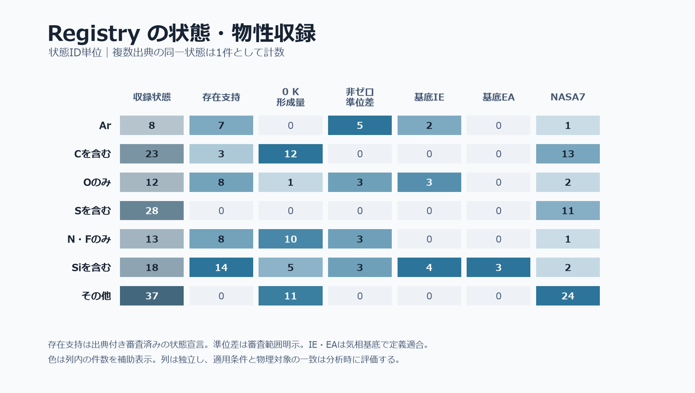
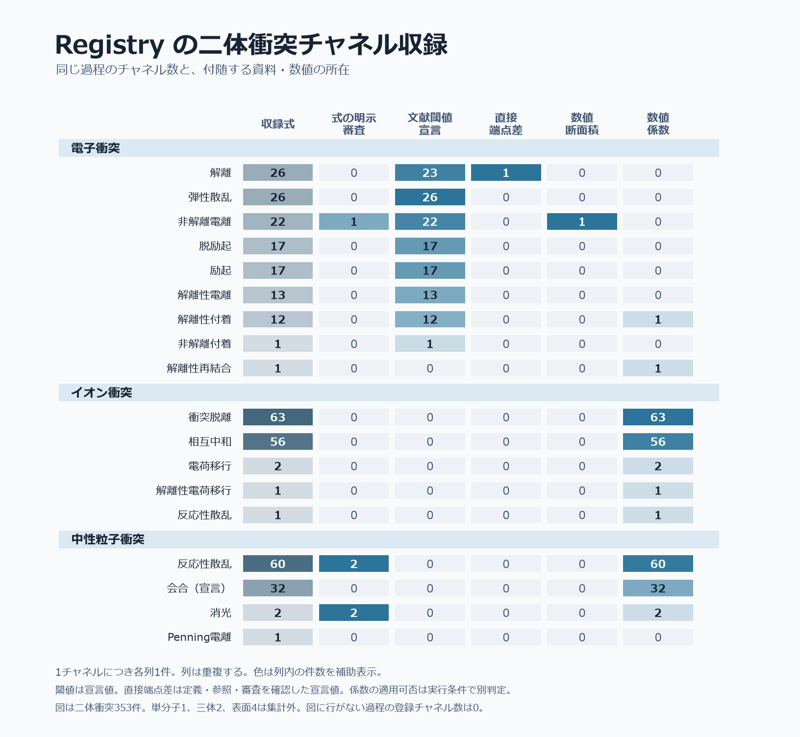
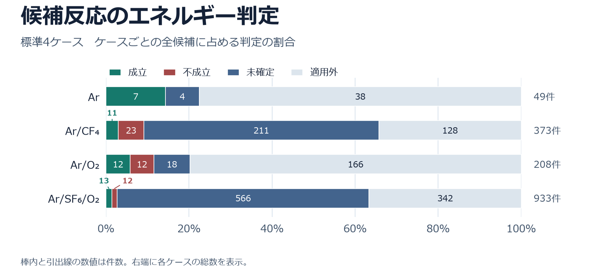

# 半導体製造の気相反応 判定・優先順位レポート

低圧プラズマによるエッチング、PECVD、PEALD、クリーニングを想定し、現行基盤の電子・イオン・中性粒子の気相衝突（P0・P1）を評価する。表の過程名は `reactions.csv` の `process` に対応する。物理上の区分が異なっても、同じ処理を使う場合はその対応を明記した。[現行設計](core_design.md)・[公開出力仕様](output_reference.md)・[データ源と証拠の流れ](data_sources.md)

## 基本対象

電子・イオン・中性粒子の弾性散乱は基本実装対象とする。その他の範囲内の反応も、対象外・保留等とする明示的な判断と理由がなければ基本実装対象とする。表の優先順位は、入力されたガス、供給粒子、装置領域に応じて反応候補を調べる順番を示す。

## 共通の計算・判定と表の読み方

### ○・△・×の意味

| 記号 | 実装範囲 | 例 |
|:---:|---|---|
| **○** | 必要な入力・資料が揃えば、その項目の結論を出す処理がある。 | 非解離電離の電荷段と出射電子数の照合。 |
| **△** | 対象の一部で判定できる、または量を計算できるが専用の判定までは行わない。 | 組成候補も作る衝突誘起解離では、対応する構造編集を持つ枝で結合切断を照合。共通準位移行では符号付き差を計算し、共鳴や専用の選択則は扱わない。 |
| **×** | その過程に対する、その項目の判定処理が未実装。 | 正味群移動の移動群と電荷は照合できるが、この過程名の判定に原子位置の結合編集はない。 |
| **―** | その項目を過程の判定対象にしない。 | 弾性散乱の結合切断や準位昇降。 |

記号は実装の範囲を示す。個別の式では、○の項目でも資料不足、同定不足、資料の競合、未入力により `unknown` となる。`fail` は該当する命題への反証、`not_applicable` は衝突対の不一致などによる適用外を表す。各結果は理由と必要な作業を保持する。

### 項目ごとの判定方法

| 表の項目 | 計算・照合の方法 | 結果の意味と主な出力 |
|---|---|---|
| **保存則（全行共通）** | 量論係数を掛けた元素・総電荷・明示核種の数を両辺で照合する。 | 式全体の収支。核種の総数と分子内の位置対応は異なる命題。`judgments/conservation.csv` |
| **式** | 過程別に、電子数、重粒子数、電荷変化、親・断片・衝突相手の対応を確認する。 | 指定した過程に対する式・粒子対応。`judgments/consistency.csv` |
| **結合** | 明示SMILESと原子対応を使い、RDKitで切断・形成・次数変更・形式電荷の編集を再生して生成構造を照合する。 | 実装済みの局所的な結合編集との整合。組成だけで生成した候補では、対応する結合編集が未確定。`judgments/consistency.csv` と正規結果の `transformation`。[R10](#r10) |
| **準位** | 同じ粒子の初終準位を照合する。励起・脱励起・消光などの方向を宣言した過程では、その方向を状態の順序または符号付き準位差で確認する。 | 粒子の内部エネルギーが上がるか下がるか。共通処理では一者・二者の準位差を扱う。`judgments/consistency.csv` と正規結果の準位差。[R9](#r9) |
| **ΔE** | 反応の量論に従って `ΔE = Σs νs E(s)` を計算し、同じ状態の項を相殺する。適格な直接端点差、共通基準の0 K形成量、または実装済みで対応が閉じる準位差・解離量・断熱IE/EAの組合せを使う。 | 指定した初終状態の差。相・構造・準位・参照基準と必要な核種を照合する。零点エネルギーを含むD₀へ重複加算しない。`judgments/energy.csv` と正規結果の `state_energy_difference_eV`。[R8](#r8) |
| **COM** | 該当する入射対の重心系エネルギー `E_COM` を使う。孤立二体・整数量論で出口に複数の粒子がある場合は、名目上 `E_COM − ΔE ≥ 0` を確認する。固定一生成物は、孤立系と明示した場合に限り余裕ゼロを検査する。 | 指定条件でのエネルギー必要条件。標的静止の実験室系からの換算は入射・標的の役割と質量を使う。`judgments/energy.csv` に適用対、エネルギー、余裕、理由を出す。 |

IEは断熱電離エネルギー、EAは電子親和力、D₀は指定した断片状態への0 K解離量。R・V・E・Tはそれぞれ回転・振動・電子準位・並進を表す。単一の衝突エネルギーは、温度や分布平均と区別して使う。適用対象で入射値を省略した場合でも、複数出口で `ΔE ≤ 0` が決まれば必要条件を満たすと判定する場合があり、数値の余裕欄は空になる。[衝突条件の実装](../src/reactgen/screening.py#L611)

| 独立に見る判定 | 何を確認するか |
|---|---|
| **参加状態・電子束縛** | `state` は指定状態への資料支持。一価基底アニオンの `electron_binding` は電子束縛を別に評価する。 |
| **熱化学・宣言値の比較** | `thermochemistry` は、適用する過程で文献の電離閾値とIE、宣言された電荷移行のエネルギー差などの関係を比較する。プロトン移動の親和力差・塩基性差はそれぞれΔH・ΔG°を与える独立計算。 |
| **反応の資料支持** | `reaction_evidence` は該当する生成物・状態を持つチャネルへの資料支持。`judgments/reaction_evidence.csv` の文献閾値は端点差と区別する。 |
| **係数利用** | `kinetics` と `data_use` は、数値記録を所定条件で係数に使えるかを評価する。候補抽出とエネルギー必要条件は、断面積・レートの有無から独立に扱う。 |

障壁、スピン選択則、分岐比、反応の発生確率、支配経路は別の評価が必要となる。電離の標的対応は核種在庫と、比較できる場合の元素結合グラフを照合する。核種位置の保持まで必要な用途では、原子対応と構造を確認する。[判定の責務](core_design.md#科学判断の境界)・[対応照合の実装](../src/reactgen/structure.py#L806)

## 製造用途での優先順位

**順位1**は、その衝突区分を扱う際に先に確認するもの、または記載した用途で活性種・電荷の収支を直接左右するもの。**順位2**は、ガス種・励起種・イオンの有無や装置領域を確認して繰り上げるもの。**順位3**は、特定の入射条件や対象機構が候補になった段階で確認するもの。同順位は同じ確認段階を表す。各衝突区分の内部で適用し、対象範囲はP0・P1とする。順位は、公式報告と各工程・ガス系の実験・モデルをもとにした本レポートの判断である。順位の数字は速度や反応割合を表さない。[R0](#r0)・[R16](#r16)

| 装置・運転条件 | 先に確認する項目 |
|---|---|
| **フルオロカーボンの直接エッチング** | 電子による解離・電離と、活性断片の生成・消費。入射イオンの種類・エネルギーを追う場合は電荷交換と、到達可能な衝突誘起解離・解離性電荷移行も優先する。[R2](#r2)・[R15](#r15)・[R16](#r16)・[R18](#r18) |
| **電気陰性ガス・負イオンを含む放電** | 解離性付着を電子の消失と陰イオンの生成に結び付け、相互中和・衝突脱離を陰イオンの消失枝として確認する。[R2](#r2)・[R6](#r6)・[R22](#r22) |
| **シラン系PECVD** | SiHₓの生成・消費。H₂が多い条件ではH引抜き、NH₃混合ではプロトン移動と副生成物付き会合を繰り上げる。[R3](#r3)・[R4](#r4)・[R17](#r17) |
| **リモートクリーニング・酸化物PEALD** | プラズマ源では原料解離と電荷収支、下流では対象ラジカルの供給・消費。イオン衝突の優先順位は下流でのイオン到達や装置構成に応じて変わる。[R12](#r12)・[R19](#r19)・[R24](#r24) |
| **希ガス準安定種を含む系・アフターグロー** | 入口の準安定種を特定し、非解離消光、解離を伴う消光、Penningや段階電離を候補として確認する。[R5](#r5)・[R11](#r11) |

## 電子衝突

| 順位 | 実装過程 | 式 | 結合 | 準位 | ΔE | COM | 具体例と判定の範囲 | 製造での優先理由 |
|:---:|---|:---:|:---:|:---:|:---:|:---:|---|---|
| 1 | 弾性散乱 `elastic` | ○ | ― | ― | ○ | ○ | `e + Ar → e + Ar`。内部状態を保持し、ΔEはゼロ。散乱角・運動量移行量は別。 | 電子輸送とエネルギー分布を扱う基礎区分。[R0](#r0) |
| 1 | 非解離電離 `ionization` | ○ | ― | ― | ○ | ○ | `e + Ar → 2e + Ar⁺`。同じ核組成で電荷+1と出射電子2個を照合。対応するIEと準位差を使う。 | 放電の電子・陽イオン生成を確認する起点。[R0](#r0)・[R12](#r12) |
| 1 | 解離・解離励起 `dissociation` | ○ | △ | ― | ○ | ○ | `e + CF₄ → e + CF₃ + F`。親の分割と断片電荷を照合。励起断片も出口で区別し、対応する構造がある枝は有限の結合切断を確認。 | エッチング・成膜・クリーニングで原料から活性種が生じる入口。[R12](#r12)・[R15](#r15) |
| 1 | 励起・脱励起 `excitation` / `deexcitation` | ○ | ― | ○ | ○ | ○ | `e + Ar ↔ e + Ar(1s5)`。同一粒子の準位対応と昇降を照合。励起準位同士で差が不明なら方向は未確定。 | 電子のエネルギー損失と準安定種・段階電離。脱励起は励起粒子がある条件で確認。[R5](#r5) |
| 2 | 解離性付着 `dissociative_attachment` | ○ | × | ― | ○ | ○ | `e + SF₆ → SF₅⁻ + F`。電子捕獲と分割を照合。負親の捕獲分裂も同じ過程名で保持し、当該出口の支持を個別確認。 | 電気陰性系の電子・陰イオン収支では順位1。分岐・共鳴は別評価。[R1](#r1)・[R22](#r22) |
| 2 | 解離性電離 `dissociative_ionization` | ○ | × | ― | ○ | ○ | `e + CF₄ → 2e + CF₃⁺ + F`。親の分割と出射電子2個を照合。親のIEだけで断片出口の端点差は決まらない。 | フルオロカーボンで分子イオン組成を追う場合は順位1。[R21](#r21) |
| 2 | 共通準位移行 `level_transfer` | ○ | ― | △ | ○ | ○ | SiH₄の振動準位間など、表現済みの回転・振動・電子準位を扱う。回転ラダーの自動生成と専用の選択則は未実装。 | 状態別の電子エネルギー損失や段階反応が目的のときに繰り上げる。[R1](#r1)・[R12](#r12) |
| 2 | 非解離脱離 `detachment` | ○ | ― | ― | ○ | ○ | `e + O⁻ → 2e + O`。負親を保ち、電荷+1と出射電子2個を照合。対応EAと準位差を使う。 | 負イオンが存在する放電・下流での電子回復を調べる枝。[R1](#r1) |
| 2 | 解離性再結合 `dissociative_recombination` | ○ | × | ― | ○ | ○ | `e + O₂⁺ → O + O`。正親の電子捕獲と分裂を区別し、励起断片も別出口にする。 | 分子陽イオンが残る領域のイオン損失とラジカル生成。 |
| 3 | イオン対生成 `ion_pair_formation` | ○ | △ | ― | ○ | ○ | `e + O₂ → e + O⁺ + O⁻`。正負断片と電子1→1を照合。対応する有限の切断も確認できる。 | イオン対の生成が対象で、入射エネルギー範囲と資料がある場合に調べる。[R1](#r1) |
| 3 | 解離性脱離 `dissociative_detachment` | ○ | × | ― | ○ | ○ | `e + AB⁻ → 2e + A + B`。負親の分割と出射電子2個を照合。親のEA、断片への解離量などが必要。 | 分子陰イオンが生成・供給される条件で、消失と断片生成を調べる。 |
| 3 | 非解離付着・再結合 `attachment` / `recombination` | ○ | ― | ― | ○ | △ | `e + A → A⁻`、`e + A⁺ → A`。固定一生成物の端点差、基底アニオンの束縛、安定化条件を区別する。 | 出口が固定一生成物の捕獲。放射や第三体を介する安定化の計算は未対応。[R6](#r6)・[R8](#r8) |

自動分割は2・3断片、各断片電荷は−1・0・+1、出射電子は0・1・2。比較対象の終状態が特定できる明示式・資料は、この機械生成範囲と区別して扱う。[候補生成](../src/reactgen/generate.py#L575)・[分割の分類](../src/reactgen/chemistry.py#L484)

## イオン衝突

反応物に自由電子がなく、イオンを含む気相の重粒子衝突を扱う。電子を生成する枝もこの区分に入る。

| 順位 | 実装過程 | 式 | 結合 | 準位 | ΔE | COM | 具体例と判定の範囲 | 製造での優先理由 |
|:---:|---|:---:|:---:|:---:|:---:|:---:|---|---|
| 1 | 弾性散乱 `elastic` | ○ | ― | ― | ○ | ○ | `Ar⁺ + Ar → Ar⁺ + Ar`。両粒子の状態保持を確認。 | イオン輸送と入射条件の基礎区分。運動量移行係数は別評価。[R18](#r18) |
| 1 | 電荷移行 `charge_exchange` | ○ | ― | ― | ○ | ○ | `A⁺ + B → A + B⁺` または負電荷の移行。核組成の保持と電荷の再配分。単価・基底の対応組ではIE差またはEA差を比較できる。 | 混合ガスでイオン組成や入射イオンの種類を追う起点。[R2](#r2)・[R7](#r7) |
| 1 | 共鳴電荷交換 `resonant_charge_exchange` | ○ | ― | ― | ○ | ○ | `Ar⁺ + Ar → Ar + Ar⁺`。同じ状態集合に加えイオンと中性の核種・構造対応を確認。対応不明は未確定。 | 希ガス希釈系のイオン輸送。式の状態集合が同じでも独立した枝として扱う。[R18](#r18) |
| 2 | 相互中和 `mutual_neutralization` | ○ | ― | ― | ○ | ○ | `A⁺ + B⁻ → A + B`。一価正負イオンから対応する二中性粒子への変換。 | 陰イオンを含む放電・アフターグローでは順位1。[R6](#r6) |
| 2 | 衝突誘起解離 `collision_induced_dissociation` | ○ | △ | ― | ○ | ○ | `X⁺ + AB → X⁺ + A + B`。親の分割と相手の状態保持。有限の結合切断を再生できる枝もある。 | 対象分子に十分な衝突エネルギーがあるとき、分子イオン・ラジカル組成に関わる。[R2](#r2) |
| 2 | 解離性電荷移行 `dissociative_charge_transfer` | ○ | × | ― | ○ | ○ | 親の分割と相手の電荷変化を対応づける。たとえば `O₂⁺ + O⁻ → 3 O` の全中性出口も同じ処理で扱う。 | フルオロカーボンの高エネルギーイオンや、分子正負イオンの中和出口に着目する条件で繰り上げる。[R2](#r2) |
| 2 | 衝突脱離 `collisional_detachment` | ○ | ― | ― | ○ | ○ | `F⁻ + CF₄ → F + CF₄ + e`。負親と相手を保持し、電子放出を照合。 | 負イオンと脱離を起こし得る入射条件がある場合の損失枝。[R2](#r2) |
| 2 | 正味群移動 `net_group_transfer` | ○ | × | ― | ○ | ○ | H⁺、H⁻、ハロゲン化物、中性群の移動を群と正味電荷で区別。プロトン移動では同温度のPA差でΔH、同温度・同標準圧のGB差でΔG°を別計算。HIA・FIAの専用計算は未対応。 | SiH₄/NH₃のプロトン移動や、SiF₄系のハロゲン化物移動では繰り上げる。[R3](#r3)・[R7](#r7)・[R14](#r14) |
| 2 | 副生成物付き会合 `net_association_loss` | ○ | × | ― | ○ | ○ | `A⁺ + B → C⁺ + D`。候補生成では有限の離脱群を列挙し、式の判定では二つの重粒子出口と組成の再配分を照合する。 | シラン系のイオン成長や副生成物を追う工程で先に見る枝。[R3](#r3)・[R13](#r13) |
| 2 | 正味会合 `net_association` | ○ | × | ― | ○ | △ | `A⁺ + B → AB⁺`。組成と電荷の合体。固定一生成物では安定化やエネルギー交換を区別する。 | 小クラスターを調べる条件で対象。会合後の安定性は別途確認。[R6](#r6)・[R7](#r7) |
| 3 | 解離性衝突脱離 `dissociative_detachment` | ○ | × | ― | ○ | ○ | `AB⁻ + X → A + B + X + e`。負親の分割・相手保持・電子放出を照合。 | 分子陰イオンを供給または生成し、分裂出口を調べる場合。 |
| 3 | 会合性脱離 `associative_detachment` | ○ | × | ― | ○ | ○ | `A⁻ + B → AB + e`。組成合体と電子放出の正味式。出口に電子がある。 | 負イオンと会合生成物が対象の条件で調べる枝。 |
| 3 | 正味群交換 `net_group_exchange` | ○ | × | ― | ○ | ○ | 二つの交換群と保持部分、粒子ごとの組成の変化を照合。 | 複数の前駆体が同時に存在し、交換生成物を区別したい場合。 |
| 3 | 準位移行付き解離 `dissociation_with_level_transfer` | ○ | △ | △ | ○ | ○ | `AB + X⁺* → A + B + X⁺` のように親の分割と相手の準位変化を照合。下降かどうかは準位差で確認。 | 既知の励起イオンが衝突相手に含まれる場合。 |
| 3 | 共通準位移行 `level_transfer` | ○ | ― | △ | ○ | ○ | 一者または二者の初終準位を照合し、各粒子の準位差を計算できる場合がある。 | イオン・相手の状態別モデルで必要になる枝。 |
| 3 | イオン誘起励起・脱励起 `ion_induced_excitation` / `ion_induced_deexcitation` | ○ | ― | ○ | ○ | ○ | 宣言された一者の準位昇降を照合。共通の機械生成名は `level_transfer`。 | 既知の励起・失活を明示式または資料で調べる場合。 |
| 3 | 衝突電離 `collision_ionization` | ○ | ― | △ | ○ | ○ | `X⁺ + A → X⁺ + A⁺ + e`。標的の電荷+1と電子放出。励起イオンが変化する枝ではその符号付き準位差を別に読む。 | 標的を電離できる重粒子の入射条件がある場合。 |
| 3 | 反応性散乱 `reactive_scattering` | △ | × | ― | ○ | ○ | 二体入口、複数出口、状態集合の変化を照合する包括名。 | 資料または明示式に対象チャネルがある場合に検討する。 |

両粒子の明示構造を用いるイオンの置換・付加などは、下の[共通の結合編集](#イオン中性に共通する結合編集)と同じ処理を使う。非解離電荷移行の自動生成は一電荷ずつで、機械生成の電荷上限は絶対値1。資料・明示式で受ける多価状態はこの上限と区別する。[生成処理](../src/reactgen/generate.py#L736)・[重粒子の過程判定](../src/reactgen/assessment.py#L1474)・[プロトン移動の計算](../src/reactgen/screening.py#L1071)

## 中性粒子衝突

| 順位 | 実装過程 | 式 | 結合 | 準位 | ΔE | COM | 具体例と判定の範囲 | 製造での優先理由 |
|:---:|---|:---:|:---:|:---:|:---:|:---:|---|---|
| 1 | 弾性散乱 `elastic` | ○ | ― | ― | ○ | ○ | `2 Ar → 2 Ar`。内部状態の保持とΔEゼロを確認。 | 中性の熱・運動量輸送の基礎区分。散乱・輸送係数は別評価。[R0](#r0) |
| 1 | 正味群移動 `net_group_transfer` | ○ | × | ― | ○ | ○ | `H + SiH₄ → H₂ + SiH₃` などの正味群移動。供与側・受容側と保持する組成・核種在庫を照合。 | H₂の多いシラン系などで活性ラジカルの生成・消費を追う起点。[R4](#r4)・[R17](#r17) |
| 1 | 反応性散乱 `reactive_scattering` | △ | × | ― | ○ | ○ | `CF₃ + O → COF₂ + F`。資料・明示式について、二体入口、複数出口と状態変化を照合。 | CF₄/O₂系で活性種収支に関わる特定のチャネルを優先する。包括名全体の順位ではない。[R20](#r20)・[R23](#r23) |
| 2 | 正味会合 `net_association` | ○ | × | ― | ○ | △ | `A + B → AB`。合体組成と終状態を扱う。固定一生成物のエネルギー交換条件を別に要求。 | 前駆体の小クラスターやラジカルの損失を追う場合に確認。[R4](#r4) |
| 2 | 副生成物付き会合 `net_association_loss` | ○ | × | ― | ○ | ○ | `A + B → C + D` のうち組成の分割が変わる枝。生成時は有限の離脱群を列挙し、式の判定では二つの重粒子出口と再配分を照合する。 | 成膜原料の気相成長と生成物の分布が目的の場合に繰り上げる。[R4](#r4) |
| 2 | 非解離消光 `quenching` | ○ | ― | ○ | ○ | ○ | `A* + B → A + B`。相手を保った一者の準位下降。電子・振動は端点の準位種別から読む。 | 希ガス準安定種の損失や下流への活性種供給を追う場合に繰り上げる。[R5](#r5)・[R11](#r11) |
| 2 | 振動緩和 `v_t_relaxation` | ○ | ― | ○ | ○ | ○ | 振動励起粒子が基底または別の振動準位に下がり、相手は同じ状態。並進への分配は未計算。 | 振動励起を状態別に扱う装置条件で確認。 |
| 2 | 共通準位移行 `level_transfer` | ○ | ― | △ | ○ | ○ | 一者・二者の有限準位を扱う。R–T、V–V、E–V、E–E、プーリング励起の各準位差を扱えるが、専用の共鳴・選択則は未実装。 | 低励起モデルから状態別モデルへ詳細化する場合に繰り上げる。[R5](#r5) |
| 2 | 準位移行付き解離 `dissociation_with_level_transfer` | ○ | △ | △ | ○ | ○ | `A* + BC → A + B + C`。親の分割と相手の状態変化を確認し、解離消光の下降方向は相手の準位差で読む。 | Ar希釈シランなど準安定粒子による解離が候補となる場合に繰り上げる。[R11](#r11) |
| 2 | Penning電離 `penning_ionization` | ○ | ― | ○ | ○ | ○ | `A* + B → A + B⁺ + e`。供与体の下降と標的電離を独立に照合。準位差と標的IEの専用比較は、状態が特定された供与体と基底標的などの条件に限定。 | 準安定希ガスや混合ガスでの電離候補。プーリング電離は別の専用判定を持たない。[R5](#r5) |
| 3 | 衝突誘起解離 `collision_induced_dissociation` | ○ | △ | ― | ○ | ○ | `X + AB → X + A + B`。親の分割と相手の保持。対応する親構造では結合切断を再生。 | 高速中性粒子など、解離に必要な衝突エネルギーを持ち得る入口を確認してから評価。 |
| 3 | 中性衝突電離 `collision_ionization` | ○ | ― | △ | ○ | ○ | 標的の電荷+1と電子放出。相手の保持や準位変化を区別し、標的のIEなどを使う。 | 非熱的な中性粒子や励起種が明示された領域で検討。 |
| 3 | 会合電離 `associative_ionization` | △ | × | ― | ○ | ○ | `A + B → AB⁺ + e`。自動生成は中性二者から陽イオンを作る。明示式の判定は重粒子数と電子数の式形に留まる。 | 励起・ラジカル入口とイオン出口を指定できる場合に確認。 |
| 3 | 正味群交換 `net_group_exchange` | ○ | × | ― | ○ | ○ | 二群と両粒子の保持部分を照合。交換の原子位置を特定する場合は別の構造根拠が必要。 | 混合前駆体で交換生成物が検討対象となる場合。 |
| 3 | 同位体交換 `isotope_exchange` | ○ | △ | ― | ○ | ○ | `H + D₂ → HD + D`。全核種を明示した中性原子ラジカルと中性閉殻分子の、立体指定のない終端単結合に限り原子対応と編集を再生。 | 同位体トレーサーや重水素工程では繰り上げる。[実行例](#明示同位体からhdへの候補経路を調べる) |

[中性候補生成](../src/reactgen/generate.py#L798)・[準位方向の判定](../src/reactgen/assessment.py#L1666)・[Penning電離の比較](../src/reactgen/assessment.py#L4549)

会合電離の明示式では `F⁻ + CF₃ → CF₄ + e` も整合判定を通る。これは物理的な区分では会合性脱離に当たるため、会合電離の `consistency: pass` から中性二者の電離と判断せず、入口・出口の電荷を確認する。[自動生成の条件](../src/reactgen/generate.py#L943)・[明示式の判定](../src/reactgen/assessment.py#L1529)

## イオン・中性に共通する結合編集

この表の順位はイオン・中性それぞれの衝突区分内で読む。式が△の行は、明示構造と対応する編集が必要。一般の正味式では組成・電荷の確認が先に成立し、特定の切断・形成位置は編集が揃う場合に確定する。各式は局所編集を説明する例であり、装置内でその経路を通るかは別途評価する。[編集の生成](../src/reactgen/structure.py#L256)・[編集の再生](../src/reactgen/structure.py#L464)

| イオン順位 | 中性順位 | 実装過程 | 式 | 結合 | 準位 | ΔE | COM | 具体例と判定の範囲 | 製造での優先理由 |
|:---:|:---:|---|:---:|:---:|:---:|:---:|:---:|---|---|
| 3 | 1 | H引抜き `radical_abstraction` | △ | ○ | ― | ○ | ○ | `H + SiH₄ → H₂ + SiH₃` のような枝。供与側のH結合切断と受容側での形成を再生。 | H₂を含むシラン成膜でラジカル種の違いを調べる。[R4](#r4)・[R17](#r17) |
| 3 | 2 | 置換 `substitution` | △ | ○ | ― | ○ | ○ | `F + SiH₄ → SiH₃F + H`。攻撃側との結合形成と離脱側結合の切断。有限のラジカル型・ヘテロリティック型を照合。 | Si–N前駆体などで、正味群移動から局所構造へ掘り下げる場合。[R4](#r4) |
| 3 | 2 | ラジカル付加 `radical_addition` | △ | ○ | ― | ○ | △ | `CH₃ + C₂H₄ → C₃H₇`。二重結合の次数低下と新しい結合形成を再生。固定一生成物のエネルギー交換条件は別評価。 | 不飽和前駆体を含む成長・ラジカル消費を調べる場合。 |
| 3 | 2 | ラジカル再結合 `radical_recombination` | △ | ○ | ― | ○ | △ | `2 CH₃ → C₂H₆`。ラジカル位置間の単結合形成を再生。固定一生成物の安定化・スピンは別評価。 | ラジカル損失、小クラスター生成の候補を調べる場合。 |
| 3 | 2 | 配位付加 `coordinate_addition` | △ | ○ | ― | ○ | △ | `NH₃ + BCl₃` のN→B付加。供与側・受容側、結合と形式電荷の変化を照合。単一アダクトのエネルギー交換条件は別評価。 | 前駆体と配位子の組み合わせで生成構造を比較する場合。 |
| 3 | 2 | 挿入 `insertion` | △ | ○ | ― | ○ | △ | `SiH₂ + H₂ → SiH₄`。元の単結合を切り、挿入中心との二つの新結合を再生。固定一生成物のエネルギー交換条件は別評価。 | シリレンなど、挿入し得る前駆体の構造を調べる場合。[R4](#r4) |
| 3 | 3 | ラジカル不均化 `radical_disproportionation` | △ | ○ | ― | ○ | ○ | `CH₃ + C₂H₅ → CH₄ + C₂H₄`。実装済みのβ-H移動と隣接π結合形成を再生。 | 対応するβ-Hを持つラジカル対を特定した場合。 |

## 過程別の反応式と判定式

以下の反応式は、個々の判定で照合する入口・出口を具体化した例である。準位記号のない粒子は基底状態を想定し、上付きの `*` は指定した励起状態、プライムは対応する出口粒子を表す。例示した式の実験支持と適用条件は個々のレコードで確認する。下表では式形・変換に固有の条件を示し、全行に共通する端点差と衝突条件の式は次の節で定義する。

### 保存則、状態対応、端点差と衝突条件

反応の符号付き量論係数を $\nu_s=n_{s,\mathrm{out}}-n_{s,\mathrm{in}}$、粒子 $s$ の元素在庫ベクトルを $\mathbf a(s)$、素電荷単位の電荷を $q(s)$ とする。自由電子は $\mathbf a(e)=\mathbf 0$、$q(e)=-1$ と数える。$N_h$ は電子以外の粒子数、$N_e$ は自由電子数。数の対 $(N_h,N_e)_{\mathrm{in}}\to(N_h,N_e)_{\mathrm{out}}$ は量論係数の合計で、$2\mathrm O$ は二粒子として数える。$S$ は量論係数を含む状態の多重集合、$C$ は重粒子の組成ベクトルの多重集合を表す。

$$
\sum_s\nu_s\mathbf a(s)=\mathbf 0,\qquad
\sum_s\nu_s q(s)=0 .
$$

核種ラベルが揃うときは、核種 $(Z,A)$ の個数 $a_{Z,A}(s)$ にも $\sum_s\nu_s a_{Z,A}(s)=0$ を適用する。ラベル不足で照合できない部分と、明示ラベルだけで収支が矛盾する場合は別の結論になる。以下の「状態保持」は組成・相・電荷・構造・内部状態の同じ参加状態を要求する。「準位変更」は核組成・相・構造に対応があり、電荷を保って内部状態が変わることを指す。電荷段を変える際は、核種在庫と比較可能な核配置の対応を調べる。[保存則](../src/reactgen/balance.py#L45)・[参加粒子の判定](../src/reactgen/assessment.py#L1231)

端点差は孤立気相の指定状態について求める。共通の基底参照と電子のゼロを使う場合、$E(s)$ は基底状態のエネルギー $E(s_g)$ とそこからの準位オフセット $\epsilon_s$ に分解できる。基底電荷段の差には、定義と対象の合う断熱値を使う。

$$
\begin{aligned}
\Delta E &= \sum_s \nu_s E(s), &
\delta_i &= E(s_{i,\mathrm{out}})-E(s_{i,\mathrm{in}}), \\
E(s)&=E(s_g)+\epsilon_s, &
E(X_g^{q+1})-E(X_g^q)&=IE_q(X)\quad(q\ge0), \\
E(X_g^-)-E(X_g^0)&=-EA(X), &
D_0(P\to F_1+\cdots+F_k)&=\sum_j E(F_j)-E(P).
\end{aligned}
$$

資料の直接端点差と0 Kの共通形成量基準のほか、上式で状態と基準が閉じる組合せを利用する。分解して得る例示式は、対応する生成物や基底準位まで特定できたときの関係である。励起粒子を含む場合、始状態のオフセットは引き、終状態のオフセットは加える。方向を判定する過程では昇降の符号 $d=+1,-1$ に対して $d\,\delta_i>0$ を照合する。差が得られない場合、片方が対応する基底なら基底と励起準位の順序を使い、両方が励起なら方向を未確定にする。[端点差と電荷段の計算](../src/reactgen/energy.py#L355)・[準位方向](../src/reactgen/assessment.py#L1666)・[R8](#r8)・[R9](#r9)

指定された入射・標的と衝突対が対応し、標的が静止する実験室系から換算するとき、入射粒子の質量を $m_p$、標的の質量を $m_t$ とする。孤立二体の名目エネルギー余裕を $M$ と書く。

$$
E_{\mathrm{COM}} = \frac{m_t}{m_p+m_t}E_{\mathrm{lab}},\qquad M=E_{\mathrm{COM}}-\Delta E .
$$

出口が二粒子以上なら $M\ge0$ を、`isolated` と明示した固定一生成物なら $M=0$ を許容誤差 $10^{-12}\,\mathrm{eV}$ で照合する。衝突対の不一致、適用対に必要な量・同定の不足、外部へのエネルギー受け渡しを扱うモデルの不足は区別する。入射値が省略された複数出口では、他の適用条件が揃い $\Delta E\le0$ であれば非負の入射エネルギーで必要条件が成立する。値が省略されたとき数値の $M$ は返さない。反応の資料支持は、式、過程、状態の解像度と出典の主張範囲の照合で別途判定する。[衝突条件と必要条件](../src/reactgen/screening.py#L611)・[実験室系の換算](../src/reactgen/screening.py#L866)・[公開仕様](output_reference.md#判定と数値利用)

### 電子衝突の詳細

非解離過程では重粒子 $X$ の対応を照合し、分裂過程では分割後の断片電荷と出射電子数で分類する。分裂表の $q_P$ は親の電荷、$q_j$ は各断片電荷、$k$ は重粒子出口数。全分裂に $N_{e,\mathrm{in}}=1$、重粒子入口一者、$k\ge2$ と $\sum_j q_j=q_P+N_{e,\mathrm{out}}-1$ が共通する。断片を自動列挙する上限と、資料・明示式を判定する式形は区別する。[非解離・分裂の式形](../src/reactgen/assessment.py#L1394)・[分裂の分類](../src/reactgen/chemistry.py#L484)

| 過程 | 反応式の例 | 照合する条件とエネルギーの読み方 |
|---|---|---|
| 弾性散乱 `elastic` | `e + Ar → e + Ar` | 二粒子で $S_{\mathrm{in}}=S_{\mathrm{out}}$。内部エネルギーは $\Delta E=0$。個々の粒子の運動量移行はこの式から求めない。 |
| 非解離電離 `ionization` | `e + Ar → Ar⁺ + 2 e`、`e + Ar⁺ → Ar²⁺ + 2 e` | $(1,1)\to(1,2)$、$q_{X'}=q_X+1$、$q_X\ge0$。対応基底端点の $\Delta E=IE_q(X)$。基底親から構造を保つ電離に適用できる文献閾値 $T$ があれば、宣言範囲で $T_{\min}\ge IE_{\max}$ は整合、$T_{\max}<IE_{\min}$ は不整合、その他は未確定。浮動小数点の換算境界には許容差を適用する。[閾値比較](../src/reactgen/assessment.py#L3913) |
| 解離・解離励起 `dissociation` | `e + CF₄ → e + CF₃ + F`、`e + O₂ → e + O(³P) + O(¹D)` | $N_{e,\mathrm{out}}=1$。中性親なら全断片が中性で、帯電親なら断片電荷の合計を親電荷に保つ。$\Delta E=D_0$ は対応する基底解離端点のとき。励起断片では指定準位を加える。結合切断の照合は対応するグラフ編集がある枝に限る。 |
| 励起 `excitation` | `e + Ar → e + Ar(1s5)` | $(1,1)\to(1,1)$、同じ電荷段の準位変更で $\delta_1>0$。$\Delta E=\delta_1$ を使う。 |
| 脱励起 `deexcitation` | `e + Ar(1s5) → e + Ar` | 励起の逆向きで $\delta_1<0$。電子のエネルギー増分を散乱角別に求める処理はない。 |
| 解離性付着 `dissociative_attachment` | `e + SF₆ → SF₅⁻ + F` | $N_{e,\mathrm{out}}=0$、$q_P\le0$。中性基底親・中性基底断片から組み立てられる例では $\Delta E=D_0-EA(\mathrm{SF_5})$。負親の枝は、その親と出口に対応した関係を使う。 |
| 解離性電離 `dissociative_ionization` | `e + CF₄ → CF₃⁺ + F + 2 e` | $N_{e,\mathrm{out}}=2$、$q_P\ge0$。中性基底親・対応する基底断片の例では $\Delta E=D_0+IE_0(\mathrm{CF_3})$。親の電離閾値だけでは断片を決められない。 |
| 共通準位移行 `level_transfer` | `e + SiH₄ → e + SiH₄(ν₄=1)` | $(1,1)\to(1,1)$、同じ電荷段の準位変更で $\Delta E=\delta_1$。ラベル自体は $\delta_1$ の符号を要求せず、回転・振動・電子の選択則も課さない。 |
| 非解離脱離 `detachment` | `e + O⁻ → O + 2 e` | $(1,1)\to(1,2)$、$q_X<0$ かつ $q_{X'}=q_X+1$。対応する一価アニオン・中性基底なら $\Delta E=EA(\mathrm O)$。 |
| 解離性再結合 `dissociative_recombination` | `e + O₂⁺ → O + O` | $N_{e,\mathrm{out}}=0$、$q_P>0$。基底一価親を中性基底親に還元できる例では $\Delta E=D_0(\mathrm{O_2})-IE_0(\mathrm{O_2})$。状態の異なる酸素原子は別出口。 |
| イオン対生成 `ion_pair_formation` | `e + O₂ → e + O⁺ + O⁻` | $N_{e,\mathrm{out}}=1$、$q_P=0$、少なくとも一つの $q_j\ne0$。電荷保存から正負両方の断片を含む。例の基底端点では $\Delta E=D_0+IE_0(\mathrm O)-EA(\mathrm O)$。 |
| 解離性脱離 `dissociative_detachment` | `e + AB⁻ → A + B + 2 e` | $N_{e,\mathrm{out}}=2$、$q_P<0$。基底一価親が中性断片になる形では $\Delta E=D_0(AB)+EA(AB)$。親を保つ非解離脱離とは出口数で区別する。 |
| 非解離付着 `attachment` | `e + O → O⁻` | $(1,1)\to(1,0)$、$q_X=0$、$q_{X'}=-1$。基底端点の $\Delta E=-EA(\mathrm O)$。一価基底アニオンの電子束縛では $EA_{\min}>0$ が支持、$EA_{\max}<0$ または整合する明示的な非束縛宣言が反証。競合・境界・欠測は未確定。固定一生成物のエネルギー必要条件も別に返す。[電子束縛](../src/reactgen/assessment.py#L717) |
| 非解離再結合 `recombination` | `e + Ar⁺ → Ar` | $(1,1)\to(1,0)$、$q_X>0$、$q_{X'}=q_X-1$。基底端点では $\Delta E=-IE_{q_X-1}(X)$。放射や第三体による安定化の計算は外部モデルを要する。 |

### イオン衝突と中性粒子衝突に共通する詳細

この表は両カテゴリーで同じ判定を使う過程をまとめる。解離系では $P$ を親、$X$ を衝突相手、$F_j$ を断片とする。共通の親・断片条件は $\sum_j\mathbf a(F_j)=\mathbf a(P)$ と相の保持。組成と電荷の照合を通過した後、編集を伴う枝では対応する構造を照合する。二体の群移動・群交換に出る $D,A$ は供与側・受容側、$D',A'$ は対応する出口。$\mathbf g,\mathbf h$ は非空の元素群ベクトルで、電荷を移す場合は元素群と電荷移動量を区別する。[分割判定](../src/reactgen/assessment.py#L1788)・[群移動](../src/reactgen/assessment.py#L1735)・[群交換](../src/reactgen/assessment.py#L2286)

| 過程 | 反応式の例 | 照合する条件とエネルギーの読み方 |
|---|---|---|
| 弾性散乱 `elastic` | イオン `Ar⁺ + Ar → Ar⁺ + Ar`、中性 `2 Ar → 2 Ar` | $(2,0)\to(2,0)$、$S_{\mathrm{in}}=S_{\mathrm{out}}$。$\Delta E=0$。運動量移行量は別途評価する。 |
| 衝突誘起解離 `collision_induced_dissociation` | イオン `F⁺ + CF₄ → F⁺ + CF₃ + F`、中性 `Ar + O₂ → Ar + 2 O` | $(2,0)\to(k+1,0)$、$k\ge2$、$X'=X$、$\sum_j q(F_j)=q(P)$。相手は端点差から相殺され、$\Delta E=\sum_jE(F_j)-E(P)$。 |
| 準位移行付き解離 `dissociation_with_level_transfer` | イオン `O₂ + Ar⁺* → 2 O + Ar⁺`、中性 `SiH₄ + Ar* → SiH₃ + H + Ar` | 同じ親分割に加え $X\to X'$ が準位変更。$\Delta E=\sum_j E(F_j)-E(P)+\delta_X$。消光として読むなら $\delta_X<0$ を個別に確認する。過程名自体は昇降を固定しない。 |
| 共通準位移行 `level_transfer` | イオン `Ar⁺* + Ar → Ar⁺ + Ar*`、中性 `A(v=1) + B(v=0) → A(v=0) + B(v=1)` | $(2,0)\to(2,0)$ で各参加粒子を状態保持または準位変更に対応づけ、$\Delta E=\sum_i\delta_i$。左右の状態集合が同じ交換には役割対応が必要。準位の共鳴幅や衝突選択則は未評価。 |
| 衝突電離 `collision_ionization` | イオン `Ar⁺ + O₂ → Ar⁺ + O₂⁺ + e`、中性 `Ar + O₂ → Ar + O₂⁺ + e` | $(2,0)\to(2,1)$、標的 $q_T\ge0$ から $q_{T'}=q_T+1$。相手は状態保持か準位変更。対応基底標的なら $\Delta E=IE_{q_T}(T)+\delta_X$、相手保持なら $\delta_X=0$。 |
| 正味群移動 `net_group_transfer` | イオン `H₃⁺ + NH₃ → H₂ + NH₄⁺`、中性 `H + SiH₄ → H₂ + SiH₃` | $(2,0)\to(2,0)$、$\mathbf a(D)-\mathbf a(D')=\mathbf a(A')-\mathbf a(A)=\mathbf g$、$q_D-q_{D'}=q_{A'}-q_A$。両側の保持部分の核種対応を調べる。プロトン移動では同温度の共役対で $\Delta H=PA(D')-PA(A)$、同温度・同標準圧の共役対で $\Delta G^\circ=GB(D')-GB(A)$。これらは0 K端点差と別計算。[PA・GBの計算](../src/reactgen/screening.py#L1071)・[R8](#r8) |
| 正味群交換 `net_group_exchange` | イオン `SiH₃⁺ + SiCl₄ → SiH₂Cl⁺ + SiHCl₃`、中性 `SiH₄ + SiCl₄ → SiH₃Cl + SiHCl₃` | $(2,0)\to(2,0)$、組成分割が変わる。$\mathbf a(D')=\mathbf a(D)-\mathbf g+\mathbf h$、$\mathbf a(A')=\mathbf a(A)-\mathbf h+\mathbf g$、$q_D=q_{D'}$、$q_A=q_{A'}$。両保持部分は非空で、核種対応を確認する。 |
| 正味会合 `net_association` | イオン `SiH₃⁺ + SiH₄ → Si₂H₇⁺`、中性 `SiH₂ + H₂ → SiH₄` | $(2,0)\to(1,0)$、保存則で $\mathbf a(P)=\mathbf a(D)+\mathbf a(A)$。同じ式で別の結合編集が候補になり得る。固定一生成物には上記の捕獲条件を適用する。 |
| 副生成物付き会合 `net_association_loss` | イオン `SiH₃⁺ + SiH₄ → Si₂H₅⁺ + H₂`、中性 `SiH₂ + SiH₄ → Si₂H₄ + H₂` | $(2,0)\to(2,0)$、$C_{\mathrm{in}}\ne C_{\mathrm{out}}$。生成は有限の離脱群 $\mathbf g$ から $\mathbf a(P)=\mathbf a(D)+\mathbf a(A)-\mathbf g$ を作る。明示式の最低条件は二体出口と組成分割の変化。 |
| 反応性散乱 `reactive_scattering` | イオン `Ar⁺ + O₂ → Ar + O₂⁺`、中性 `CF₃ + O → COF₂ + F` | $(2,0)\to(k,0)$、$k\ge2$、$S_{\mathrm{in}}\ne S_{\mathrm{out}}$。広い式形の判定なので、イオンの例の電荷移行を識別するには対応する専用過程の判定を使う。 |

### イオン衝突に固有の詳細

電荷移行では一方の粒子の電荷変化が他方と相殺する。保存則を満たしても、両方の出口を同じ核組成・相・対応する核種／構造で照合できるかが別に残る。基底・一価の専用エネルギー差は、対応する相手と出口の照合ができた場合に使う。適格な差の宣言範囲 $[L_s,U_s]$ と導出範囲 $[L_d,U_d]$ の比較では、$\max(L_s,L_d)\le\min(U_s,U_d)$ または換算の許容差内であれば整合、離れていれば不整合、必要な値の不足・競合は未確定。[電荷移行と中和の式形](../src/reactgen/assessment.py#L1474)・[電荷移行のエネルギー差](../src/reactgen/assessment.py#L4427)・[宣言値の比較](../src/reactgen/assessment.py#L3800)

| 過程 | 反応式の例 | 照合する条件とエネルギーの読み方 |
|---|---|---|
| 電荷移行 `charge_exchange` | `Ar⁺ + O₂ → Ar + O₂⁺`、負電荷の例 `O⁻ + F → O + F⁻` | $(2,0)\to(2,0)$、$C_{\mathrm{in}}=C_{\mathrm{out}}$、$S_{\mathrm{in}}\ne S_{\mathrm{out}}$、$\Delta q_A=-\Delta q_B\ne0$。$A^++B\to A+B^+$ の基底端点では $\Delta E=IE_0(B)-IE_0(A)$。$A^-+B\to A+B^-$ なら $\Delta E=EA(A)-EA(B)$。 |
| 共鳴電荷交換 `resonant_charge_exchange` | `Ar⁺ + Ar → Ar + Ar⁺` | $(2,0)\to(2,0)$、$S_{\mathrm{in}}=S_{\mathrm{out}}$、イオンと中性の核種・構造が対応。端点の差はゼロ。交換と弾性は同じ式でも過程を分けて保存する。 |
| 相互中和 `mutual_neutralization` | `O₂⁺ + O⁻ → O₂ + O` | 入口の電荷対 $(-1,+1)$、出口は $(0,0)$、重粒子は二対二で組成の対応を保持。例の基底端点では $\Delta E=EA(\mathrm O)-IE_0(\mathrm{O_2})$。 |
| 解離性電荷移行 `dissociative_charge_transfer` | `O₂⁺ + O⁻ → 3 O` | $(2,0)\to(k+1,0)$、$k\ge2$、$q(X')\ne q(X)$。$\sum_j q(F_j)-q(P)=q(X)-q(X')$。一方の親の分割があるため、非解離の電荷移行差だけでは収支が閉じない。 |
| 衝突脱離 `collisional_detachment` | `F⁻ + CF₄ → F + CF₄ + e` | $(2,0)\to(2,1)$、$q(P)<0$、$q(P')=q(P)+1$、$X'=X$。例の端点差は $EA(\mathrm F)$。 |
| 解離性衝突脱離 `dissociative_detachment` | `AB⁻ + Ar → A + B + Ar + e` | $(2,0)\to(k+1,1)$、$k\ge2$、$q(P)<0$、$X'=X$、$\sum_jq(F_j)=q(P)+1$。一価基底親が中性基底断片になる形では $\Delta E=D_0(AB)+EA(AB)$。 |
| 会合性脱離 `associative_detachment` | `F⁻ + CF₃ → CF₄ + e` | $(2,0)\to(1,1)$、負イオンを少なくとも一つ含む。全式の保存で出口電荷を照合する。電子も出口粒子なので、複数出口の $M\ge0$ を適用する。 |
| イオン誘起励起 `ion_induced_excitation` | `Ar⁺ + Ar → Ar⁺ + Ar(1s5)` | $(2,0)\to(2,0)$、一者の準位変更で $\delta_1>0$、もう一者は状態保持。$\Delta E=\delta_1$。 |
| イオン誘起脱励起 `ion_induced_deexcitation` | `Ar⁺ + Ar(1s5) → Ar⁺ + Ar` | 一者の準位変更で $\delta_1<0$、もう一者は状態保持。$\Delta E=\delta_1$。 |

### 中性粒子衝突に固有の詳細

消光と振動緩和では、下降する粒子と状態を保つ相手を区別する。Penning電離では電子励起供与体の下降と標的の電離を照合した後、適用可能な場合に独立のエネルギー比較を行う。[準位方向](../src/reactgen/assessment.py#L1630)・[IUPAC Penning電離](https://goldbook.iupac.org/terms/view/12520)・[Penning電離の宣言比較](../src/reactgen/assessment.py#L4549)

| 過程 | 反応式の例 | 照合する条件とエネルギーの読み方 |
|---|---|---|
| 非解離消光 `quenching` | `Ar(1s5) + SiH₄ → Ar + SiH₄` | $(2,0)\to(2,0)$、一者の準位変更で $\delta_1<0$、相手は状態保持。$\Delta E=\delta_1$。 |
| 振動緩和 `v_t_relaxation` | `SiH₄(ν₄=1) + Ar → SiH₄ + Ar` | 一者が振動励起から基底または別振動準位に下降し、$\delta_1<0$、相手は状態保持。全端点差は $\Delta E=\delta_1$。並進へのエネルギー分配は出力しない。 |
| Penning電離 `penning_ionization` | `Ar(1s5) + NO → Ar + NO⁺ + e` | $(2,0)\to(2,1)$、標的は $q_{T'}=q_T+1$、供与体は電子準位から $\delta_D<0$。基底標的・基底生成物では $\Delta E=IE_0(T)-\epsilon_D$。適格な宣言値の範囲では、$[\epsilon_{D,\min}+E_{\mathrm{COM}}-IE_{\max},\ \epsilon_{D,\max}+E_{\mathrm{COM}}-IE_{\min}]$ を比較し、全域非負なら整合、入射値が決まり全域負なら不整合、重なりや入射値不足なら未確定。入射値が省略された場合は運動項の下限0で成立を判定できる場合がある。 |
| 会合電離 `associative_ionization` | `A* + B → AB⁺ + e` | 自動生成は中性入口二者から一価陽イオンと電子を作る。明示式で直接照合するのは $(2,0)\to(1,1)$。物理区分を確認する際は、各入口の電荷ゼロと出口イオンの $q=+1$ も個別に読む。 |
| 同位体交換 `isotope_exchange` | `¹H + ²H₂ → ¹H²H + ²H` | 二体対二体で各量論係数1。入口原子 $a$ と離脱原子 $b$ は $Z_a=Z_b$、$A_a\ne A_b$。終端単結合を置換し、全原子の同位体と対応を照合する。例では $\Delta E=E(\mathrm{HD})+E(\mathrm D)-E(\mathrm H)-E(\mathrm{D_2})$。 |

### イオン・中性に共通する局所結合編集の詳細

同じ原子番号付けで入口グラフ $G_{\mathrm{in}}$ に指定編集 $\mathcal T$ を再生し、$\mathcal T(G_{\mathrm{in}})=G_{\mathrm{out}}$ を、生成粒子ごとの原子対応・結合・形式電荷・ラジカルの表現を含めて照合する。以下で $b_{ij}$ は結合次数、$r_i$ はRDKit上のラジカル電子数、$f_i$ は形式電荷。0は結合なし。構造を同定できない枝と、再生したグラフが一致しない枝は別の結論になる。$\Delta E$ と衝突条件は、照合した出口粒子について共通式を使う。[結合編集の再生](../src/reactgen/structure.py#L464)・[各編集操作](../src/reactgen/structure.py#L850)・[R10](#r10)

| 過程 | 反応式の例 | 再生する局所条件 |
|---|---|---|
| H引抜き `radical_abstraction` | `H + SiH₄ → H₂ + SiH₃` | 供与中心 $c$ と水素 $h$ の $b_{ch}:1\to0$、引抜き側 $a$ との $b_{ah}:0\to1$。$\Delta r_a=-1$、$\Delta r_c=+1$。 |
| 置換 `substitution` | `F + SiH₄ → SiH₃F + H` | 中心 $c$ と離脱原子 $l$ の $b_{cl}:1\to0$、攻撃原子 $a$ と中心の $b_{ac}:0\to1$。ラジカル型は $(\Delta r_a,\Delta r_l)=(-1,+1)$、ヘテロリティック型は $(\Delta f_a,\Delta f_l)=(+1,-1)$。 |
| ラジカル付加 `radical_addition` | `CH₃ + C₂H₄ → C₃H₇` | 二重結合の近側 $n$、遠側 $f$ に対し $b_{nf}:2\to1$、$b_{an}:0\to1$。$(\Delta r_a,\Delta r_f)=(-1,+1)$。 |
| ラジカル再結合 `radical_recombination` | `2 CH₃ → C₂H₆` | 二つのラジカル中心で $b_{ab}:0\to1$ と $(\Delta r_a,\Delta r_b)=(-1,-1)$。 |
| 配位付加 `coordinate_addition` | `NH₃ + BCl₃ → H₃N–BCl₃` | 対応する供与・受容中心に配位結合を形成。生成側の電荷分離表現では $b_{da}:0\to1$ と $(\Delta f_d,\Delta f_a)=(+1,-1)$。宣言された配位結合型の編集も供与・受容条件を照合する。 |
| 挿入 `insertion` | `SiH₂ + H₂ → SiH₄` | 元の結合 $b_{ab}:1\to0$、挿入中心 $c$ との $b_{ac},b_{cb}:0\to1$、$\Delta r_c=-2$。 |
| ラジカル不均化 `radical_disproportionation` | `CH₃ + C₂H₅ → CH₄ + C₂H₄` | β位 $b$ の $b_{bh}:1\to0$、受容側 $a$ の $b_{ah}:0\to1$、隣のラジカル中心 $c$ との $b_{bc}:1\to2$。$(\Delta r_a,\Delta r_c)=(-1,-1)$。 |

### 保存結果で読み分ける例

- **電子衝突** `e + CF₄ → e + CF₃ + F` では、端点差は約5.595 eVで、重心系12 eVでの名目余裕は約+6.405 eVとなる。報告された12.5 eVはCF₃生成の出現閾値であり、この測定が直接支持する範囲はCF₃生成までとなる。[R15](#r15)
- **イオン衝突** Ar⁺を明示供給し、Ar⁺とArの重心系1 eVを指定した例では、共鳴電荷交換の過程整合とエネルギー必要条件は成立し、文献支持は未確定となった。同梱4ケースはイオンを初期供給せず深さ1で打ち切るため、同じ過程を試すにはイオンが入口に届く設定が必要になる。
- **中性粒子衝突** CF₄/O₂の実行例では、`CF₃ + O → COF₂ + F` の端点差と指定エネルギーを比較できる。同梱ケースで指定が電子衝突対だけの場合、中性枝の `energy` は指定条件の適用外になる。[CF₄/O₂の実行例](#cf₄o₂の酸化経路を調べる)

## 範囲を別判断するもの

自動生成は単価中心の有限探索で、外部記録に明示された多価状態も候補として扱える。単分子過程は内部エネルギーとその準備条件、表面過程は材料・表面状態と収支の境界、放射・第三体安定化は外部へのエネルギー受け渡しを扱う。これらの詳細機構は気相二体衝突とは別のモデル範囲に置く。明示式の `three_body_association` には第三体を保持する式形の照合があり、安定化の判定には別のモデルが必要になる。[三体会合の式の判定](../src/reactgen/assessment.py#L1372)

## 現行Registryの収録範囲

### 集計範囲と単位

同梱の `registry/` を通常の `Registry.load` と `EvidenceCatalog.load_paths` で読み込んだ。状態は正規状態ID、チャネルは衝突区分・過程・向き付きの式・第三体／表面・安定化指定の組で数えた。別出典の数値記録を状態数やチャネル数へ加算していない。外部取得先の台帳、未採用スナップショット、機械生成候補は収録数に含めていない。[集計入口](../src/reactgen/registry.py)・[証拠カタログ](../src/reactgen/evidence.py)・[出典と適用条件](source_license_policy.md)

| 集計対象 | 件数と内訳 |
|---|---|
| 気相状態 | 139状態。中性95、陽イオン29、陰イオン15。組込み電子を含め、独立出典などを保持する状態証拠は214件。 |
| Registryチャネル | 360件。うち二体衝突353件（電子135、イオン123、中性95）。別範囲に単分子1、三体2、表面4を収録。 |
| 数値・参照記録 | 317件。実数を収録したレート式219件、断面積数表1件、数値未収録の参照97件（断面積90、レート3、表面付着4）。 |

掲載したベンチマークに対応するGit収録版のRegistry指紋は `f23e08097518a9a00255fbe13faa3cfee248c03859ac7ddb1e3852f3d0a62b4b`。次の図は同じ集計対象を物性・過程の別々の軸から示す。

### 状態・物性



図の「存在支持」は出典付きの審査済み存在宣言がある40状態。「0 K形成量」は参照温度0 Kの資格付き形成エンタルピーがある39状態。「非ゼロ準位差」は準位差を明示の審査対象とした14状態。「基底IE／EA」は気相基底・量の定義・対応する電荷段の資格を満たす数値を収録した9／3状態。原子の基底間値も含む。熱化学モデルの資格を持つNASA7は54状態にある。元素系は図の区分順に割り当て、重複させていない。各列は別の命題で、値の採用には入力との対象・条件の照合が必要になる。[量の資格](registry_data_guide.md#出典と資格)

| 系 | 揃っている資料と、次に必要な資料 |
|---|---|
| Ar | 基底・陽イオンの電荷段に加え、4sの個別準位とAr⁺の微細準位を収録。段階電離や個別準位のエネルギー収支に使える。準位人口、個別準位の断面積、Ar⁺の輸送用断面積は別途必要。 |
| C系・O系 | CFₓ・COF₂などの選択した0 K端点、Oの電子準位、O₂の基底IEと基底OへのD₀を収録。CF₄/O₂では特定の生成・消費枝の端点を比較できる。全断片状態、全酸化枝、生成物別の反応速度を満たすには追加資料が必要。 |
| S系 | SFₓ・SOₓFᵧを含む28状態と、うち11状態の資格付きNASA7を収録。図の基準に合う明示の存在支持・0 K形成量はこの区分で0。解離や負イオン枝を状態別に絞るには、終状態の同定、0 K端点、付着・脱離チャネルの裏付けが優先される。 |
| NFₓ・SiHₓ | 電荷段・断片の0 K形成量と、NFの電子準位、NF₃のν₂、SiH₄のν₄、SiH₂の一重項・三重項などを収録。選択した励起、親電離、解離の端点差に使える。個別の回転状態や同位体、枝ごとの断面積・レートには追加資料が必要。 |

現行処理が受け付けるプロトン親和力・気相塩基性の値は同梱状態記録に0件。分極率37状態、双極子71状態、衝突半径21状態、井戸深さ21状態には数値宣言がある。この集計には旧来の導入値・推定値も含まれる。衝突ポテンシャルやDNTの入力として採用する場合は、粒子対、量の定義、パラメータの出典、適用条件を個別に確認する。[収録値の出典と条件](source_license_policy.md#物性と分光の出典)

### 過程と反応チャネル



- **式の明示審査**は `review_scope: [channel_assertion]` を明示し、チャネル支持の資格を満たす5件。Hの電子電離1件とO(¹D)消光4件が該当する。旧来の無範囲指定の `curated` 系記録も現行コードの互換規則では審査済みとして評価され得るため、図の列は範囲を明示した件数に限定した。[チャネル審査の資格](../src/reactgen/records.py#L1709)
- **文献閾値宣言**は131チャネル。宣言値、弾性などの0 eV、予測値を含む。**直接端点差**は11チャネルに数値宣言があり、気相の特定した端点、定義、参照条件と審査の要件を満たす直接値は基底O₂から基底O原子2個への解離1件。状態側の資料から導出する端点差はこの列の外にある。[直接端点差の要件](../src/reactgen/assessment.py#L5580)・[O₂の出典](source_license_policy.md#物性と分光の出典)
- **数値断面積**はH(1s)の電子電離1件。積分断面積の収録範囲は13.6–100000 eV、宣言されたfit適用範囲は13.601–100000 eV。電子弾性・励起・解離やAr⁺の電荷交換・弾性に使う数値曲線は未収録。断面積の収録・利用と、電子分布で平均した速度係数の算出は別の処理となる。[CollisionDBの収録・適用範囲](source_license_policy.md#反応数値の出典と適用条件)
- **数値係数**を持つ219チャネルのうち207件はPateau由来167件とSon由来40件。前者は汎用式の参加種展開を含み温度・圧力の適用範囲は未確認。後者は700 Kの点に限られる。O(¹D)の現行JPL 4式は生成物を区別するが、O(³P)の個別Jへの配分は行えない。旧JPLの総過程値と、他の総過程係数も分岐へ転用しない。係数を持つチャネル数は、任意のベンチマーク条件で採用できる件数と独立して読む。[係数の出典・適用範囲](source_license_policy.md#反応数値の出典と適用条件)

図に行がない過程の登録チャネル数は0。例えばイオン・中性の弾性、共鳴電荷交換、正味群移動・交換、同位体交換、結合編集の各過程は候補を判定できる実装があり、対応するRegistryのチャネル記録は未収録。中性の「会合（宣言）」はRegistryの過程名 `association`、機械生成の `net_association` は評価表の正味会合を指す。入力の具体条件でどの数値・根拠が採用されたかは、`judgments/` と `rgen records` で対象別に確認する。[保存結果の読み方](output_reference.md#判定と数値利用)

## ベンチマークとDNT向け出力

現行の同梱4ケースを `analyze` で実行し、正規YAMLの再読込みと補助CSVの照合を行った。全ケースで `max_depth=1` に達し、終了コード1と部分探索の結果を保存した。以下の反応数は候補数で、資料支持やエネルギーの各判定は独立して集計している。指定条件で採用できる速度係数は4ケースとも0件だった。[ケース比較CSV](benchmarks/summary.csv)・[測定値とハッシュ](benchmarks/current.json)

| 標準入力 | 状態 | 反応候補 | エネルギー判定 成立／不成立／未確定／適用外 | 資料支持あり | 結果ZIP |
|---|---:|---:|---:|---:|---|
| Ar | 12 | 49 | 7／0／4／38 | 3 | [Ar](benchmarks/results/ar.zip) |
| Ar/CF₄ | 66 | 373 | 11／23／211／128 | 11 | [Ar/CF₄](benchmarks/results/ar_cf4.zip) |
| Ar/O₂ | 31 | 208 | 12／12／18／166 | 10 | [Ar/O₂](benchmarks/results/ar_o2.zip) |
| Ar/SF₆/O₂ | 127 | 933 | 13／12／566／342 | 28 | [Ar/SF₆/O₂](benchmarks/results/ar_sf6_o2.zip) |

各ZIPを展開すると、再現入力 `case.yaml`、元の `result.yaml`、反応・状態の一覧、判定別CSV、Registryの帰属記録を開ける。`rgen view` には展開先を指定する。

### ベンチマークの比較図



| 図 | 比較する量 |
|---|---|
| [標準ケースの実行時間](benchmarks/figures/cli_wall_time.png) | CLIの起動から結果保存までの実測時間。各ケース1回。 |
| [正規YAMLの読込み時間](benchmarks/figures/yaml_read_time.png) | 2種類のパーサーについて、構文解析と正規結果の検証にかかった時間を分けて表示。 |
| [DNT候補と文献支持](benchmarks/figures/dnt_evidence.png) | Ar⁺を供給した補足4ケースの候補数と、そのうち資料支持がある件数。 |

### 標準ケースの反応と経路の図

エネルギー余裕図は、指定衝突対で重心系エネルギーと端点差の両方が得られた枝を表示する。代表経路図の `--checked` は保存された必要条件を確認した経路、`conditioned` は必要条件が未確定の枝を含めて確認できる候補経路を示す。

| ケース | 重心系エネルギー余裕 | 代表経路 |
|---|---|---|
| Ar | [e＋Ar](benchmarks/figures/cases/ar/energy-Ar-ground-e-fd698760.svg) | [Ar⁺（`--checked`）](benchmarks/figures/cases/ar/pathway.png) |
| Ar/CF₄ | e＋CF₄ [1ページ目](benchmarks/figures/cases/ar_cf4/energy-CF4-ground-e-99a47f80-001.svg)・[2ページ目](benchmarks/figures/cases/ar_cf4/energy-CF4-ground-e-99a47f80-002.svg) | [CF₃（`conditioned`）](benchmarks/figures/cases/ar_cf4/pathway.png) |
| Ar/O₂ | [e＋O₂](benchmarks/figures/cases/ar_o2/energy-O2-ground-e-757e9680.svg) | [O（`--checked`）](benchmarks/figures/cases/ar_o2/pathway.png) |
| Ar/SF₆/O₂ | [e＋SF₆](benchmarks/figures/cases/ar_sf6_o2/energy-SF6-ground-e-f2e7bf1c.svg)・[e＋O₂](benchmarks/figures/cases/ar_o2/energy-O2-ground-e-757e9680.svg) | [SF₅（`conditioned`）](benchmarks/figures/cases/ar_sf6_o2/pathway.png) |

### DNT補足ケースの結果

標準入力の初期供給にイオンがないため、深さ1ではDNT向けの入口が生じない。補足4ケースではAr⁺を明示供給した。Ar/CF₄のみ、Ar⁺–Arの重心系1 eVとAr⁺–CF₄の重心系20 eVを比較用に指定した。ほかの補足ケースは元の衝突条件を保持する。

| 補足ケース | DNT向け粒子対 | 候補チャネル | 全結果ZIP | 粒子対CSV | チャネルCSV | DNT向けYAML |
|---|---:|---:|---|---|---|---|
| Ar + Ar⁺ | 1 | 48 | [全結果](benchmarks/results/ar_ion.zip) | [粒子対](benchmarks/dnt/ar_ion_pairs.csv) | [チャネル](benchmarks/dnt/ar_ion_channels.csv) | [出力](benchmarks/dnt/ar_ion.yaml) |
| Ar/CF₄ + Ar⁺ | 2 | 283 | [全結果](benchmarks/results/ar_cf4_ion.zip) | [粒子対](benchmarks/dnt/ar_cf4_ion_pairs.csv) | [チャネル](benchmarks/dnt/ar_cf4_ion_channels.csv) | [出力](benchmarks/dnt/ar_cf4_ion.yaml) |
| Ar/O₂ + Ar⁺ | 2 | 168 | [全結果](benchmarks/results/ar_o2_ion.zip) | [粒子対](benchmarks/dnt/ar_o2_ion_pairs.csv) | [チャネル](benchmarks/dnt/ar_o2_ion_channels.csv) | [出力](benchmarks/dnt/ar_o2_ion.yaml) |
| Ar/SF₆/O₂ + Ar⁺ | 3 | 488 | [全結果](benchmarks/results/ar_sf6_o2_ion.zip) | [粒子対](benchmarks/dnt/ar_sf6_o2_ion_pairs.csv) | [チャネル](benchmarks/dnt/ar_sf6_o2_ion_channels.csv) | [出力](benchmarks/dnt/ar_sf6_o2_ion.yaml) |

粒子対CSVで中性粒子の物性値と宣言状況を確認し、チャネルCSVを同じ粒子対で絞ると、反応式と各判定を比較できる。例えばAr/SF₆/O₂の表で `reaction_evidence_verdict` を `pass` に絞ると、資料支持がある枝を特定できる。物性の出典と計算入力の詳細はYAMLにある。

イオンの衝突エネルギーを指定したAr/CF₄補足ケースは、衝突対ごとにエネルギー余裕を確認できる。[Ar⁺＋Ar（重心系1 eV）](benchmarks/figures/cases/ar_cf4_ion/energy-Ar-ground-Ar-ground-2afae54c-selection-38cc3865.svg)・[Ar⁺＋CF₄（重心系20 eV）](benchmarks/figures/cases/ar_cf4_ion/energy-Ar-ground-CF4-ground-95330a7a-selection-38cc3865.svg)

たとえば Ar⁺ + CF₄ の出力では、分極率2.824 ų、永久双極子0 D、換算質量約27.476 amuを確認できる。衝突半径2.35 Åは工学的な初期値として出典を保持した。輸送フィット用の別の分極率はこの値と入れ替えていない。Ar⁺ + SF₆ → Ar + F + SF₅⁺ は保存結果で資料支持あり、端点差は未確定である。

DNT+は非極性標的、DNT+DMは永久双極子を持つ標的を扱う拡張を含む。出力のモデル候補は保存された双極子の値を基にし、欠測・競合時は `null` とする。外部計算に使う前にチャネル、相互作用パラメータ、エネルギー格子、ソルバー形式を確定する。ここでのYAMLは現行の前処理形式で、旧版の対別ファイルやソルバー専用形式への変換は別工程となる。[DNT+ 原論文](https://doi.org/10.1116/6.0002098)・[DNT+DM 原論文](https://doi.org/10.1116/6.0003762)・[出力の仕様](output_reference.md#dnt向けの出力)

```powershell
python -m reactgen.cli analyze --input docs/benchmarks/ar_cf4_ion.yaml --evidence registry --out build/benchmark-ar-cf4-ion
python -m reactgen.cli view build/benchmark-ar-cf4-ion --kind dnt
python tools/benchmark_result_io.py build/benchmark-ar-cf4-ion --compare-python-parser
```

上の例の `analyze` は部分探索の終了コード1で正規結果を保存する。その結果に対して後続の2コマンドを実行できる。読込み測定は正規YAMLのパースと検証を分け、反応候補の計算時間を含めない。

## 実行例

以下では利用する状態・物性を明示して必要条件を比較し、保存した候補経路を表示する。[経路モードの仕様](output_reference.md#形式7以降の計算と経路)

### NF₃・SiH₄の状態別候補を比較する

`rgen analyze --input case.yaml --evidence registry --out result` で、たとえば次の入力から基底SiH₄に対する衝突を比較できます。NF₃を調べる場合は `gases`、`target_state` と指定エネルギーを入れ替えます。`result/judgments/energy.csv` で各枝の判定と適用した入射条件を確認できます。

```yaml
gases: [SiH4]
supplies: [e]
conditions: {projectile_state: e, target_state: SiH4, collision_energy_eV: 3, collision_energy_frame: com}
limits: {max_atoms: 5, max_depth: 1, expand_unresolved_states: false}
```

| 入力の重心系衝突エネルギー | 比べる反応 | 端点差とエネルギー判定 |
|---|---|---|
| e＋NF₃、13 eV | NF₂＋Fの生成／親の電離／NF₂⁺＋Fへの解離性電離 | 2.484 eV `pass`／12.644 eV `pass`／14.108 eV `fail` |
| e＋NF、2 eV | a¹Δ／b¹Σ⁺への励起 | 1.418 eV `pass`／2.344 eV `fail` |
| e＋SiH₄、3 eV | SiH₂の一重項／三重項とH₂の生成 | 2.372 eV `pass`／3.312 eV `fail` |
| e＋SiH₄、3 eV | SiH₃＋Hの生成／SiH₃⁻＋Hへの解離性付着 | 3.918 eV `fail`／2.512 eV `pass` |
| e＋SiH₄、0.11／0.12 eV | ν₄=1への振動励起 | 0.11326 eV、0.11では `fail`、0.12では `pass` |

値は0 K形成量、断熱電離・電子親和力、分光の準位差を対応する端点に使った名目差です。各式の出典と選択した量は保存結果から辿れます。`pass` は指定したエネルギーの必要条件を表し、発生確率や分岐には別の根拠が要ります。[ATcT v1.228](https://atct.anl.gov/Thermochemical%20Data/version%201.228/)・[NF二原子分子定数](https://webbook.nist.gov/cgi/cbook.cgi?ID=C13967061&Mask=1000)・[SiH₂の分光](https://doi.org/10.1039/D5CP00558B)

### CF₄/O₂の酸化経路を調べる

次の `fluorocarbon.yaml` は、供給電子によるCF₄とO₂の解離、その生成物CF₃とOの衝突を個別に比較する入力例です。衝突エネルギーは各枝を調べる指定点です。

```yaml
gases: [CF4, O2]
supplies: [e]
conditions:
  collision_pairs:
    - {projectile_state: e, target_state: CF4, collision_energy_eV: 12, collision_energy_frame: com}
    - {projectile_state: e, target_state: O2, collision_energy_eV: 12, collision_energy_frame: com}
    - {projectile_state: CF3, target_state: O, collision_energy_eV: 0.1, collision_energy_frame: com}
limits: {max_atoms: 5, max_depth: 2, max_reactions: 700, expand_unresolved_states: false}
```

```powershell
rgen analyze --input fluorocarbon.yaml --evidence registry --out fluorocarbon_result
rgen view fluorocarbon_result --kind network --target COF2@ground --via rxn_cf254a79941b
rgen view fluorocarbon_result --kind pathway --target COF2@ground --via rxn_cf254a79941b
rgen view fluorocarbon_result --kind csv --judgment energy --verdict pass
rgen records fluorocarbon_result --target rxn_cf254a79941b --quantity delta_e_eV --detail
```

基底端点の差は、CF₄ → CF₃＋Fで約5.59 eV、O₂ → 2Oで約5.12 eV、CF₃＋O → COF₂＋Fで約−3.19 eVとなります。3枝とも指定した衝突のエネルギー必要条件を満たします。`--via` を指定した図は、二つの解離を前段に持つ酸化経路を表示します。指定しない場合は、最小深さの代表候補が表示されます。化学式だけで表した多原子種は、存在を支持する分光資料がある場合も、`--checked` の構造同定条件は別に確認します。探索の打切りと部分結果の範囲は、保存した生成情報と図で確認できます。[ATcT v1.228](https://atct.anl.gov/Thermochemical%20Data/version%201.228/)・[混合プラズマの実験と反応表](https://doi.org/10.3390/coatings11080906)

### Arの段階電離を通常入力で辿る

`argon_case.yaml` に中性Ar、電子供給、基底状態と準安定状態の電子衝突エネルギーを指定する。二段の経路を確認するため探索深さを2にする。

```yaml
gases: [Ar]
supplies: [e]
conditions:
  collision_pairs:
    - {projectile_state: e, target_state: Ar, collision_energy_eV: 12, collision_energy_frame: com}
    - projectile_state: e
      target_state: Ar@1s5
      collision_energy_eV: 5
      collision_energy_frame: com
limits: {max_depth: 2, max_atoms: 1, max_reactions: 300, expand_unresolved_states: false}
```

同梱Registryの `Ar@1s5` はAr Iの `3p⁵(²P°₃⁄₂)4s ²[3/2]°₂` に対応する。この準位の基底状態からの差と、基底Arの断熱電離エネルギーを使う。[Ar I準位表](https://physics.nist.gov/PhysRefData/Handbook/Tables/argontable5.htm)・[Arの電離エネルギー](https://physics.nist.gov/cgi-bin/ASD/ie.pl?spectra=argon&units=1)

```powershell
rgen analyze --input argon_case.yaml --evidence registry --out ar_level
rgen view ar_level --kind pathway --checked --target Ar+@ground
rgen view ar_level --kind network --checked --target Ar+@ground
```

基底Arの直接電離に必要な差は約15.7596 eVで、12 eVの枝は除外される。`e + Ar → e + Ar(1s5)` の約11.5484 eVと、`e + Ar(1s5) → 2e + Ar⁺` の約4.2113 eVを計算し、指定した12 eVと5 eVで必要条件を満たす二段を辿れる。条件付き経路では、未同定・集約準位や別の入射対の枝も理由付きで残る。各段に指定したエネルギーは独立した比較条件であり、衝突確率、同じ電子が続けて衝突するか、準位の人口と寿命は個別に評価する。

### 明示同位体からHDへの候補経路を調べる

`isotope_case.yaml` では、`H2` と追加供給 `H` の核種をSMILESで指定する。構造編集には[構造編集用の追加依存](../README.md#入力)が必要。

```yaml
gases: [H2]
supplies: [H]
structures: {H2: '[2H][2H]', H: '[1H]'}
conditions: {collision_energy_eV: 0.10, collision_energy_frame: com}
limits: {max_depth: 1, max_atoms: 2}
```

`isotope_d0.yaml` にはD₂とHDの指定基底状態からの解離量を記入する。各物性を使う際は、D₂とHDの `v=0, J=0` と対応する基底原子を指定していることを確認する。原資料のD₀から端点差 `D₀(D₂) − D₀(HD) ≈ 0.04247 eV` を求める。[Liu et al., D₂](https://doi.org/10.1063/1.3374426)・[Sprecher et al., HD](https://doi.org/10.1063/1.3483462)

```yaml
snapshot_version: 1
records:
- reaction: 'H2@ground;structure=smiles%3A%5B2H%5D%5B2H%5D -> 2 H@ground;structure=smiles%3A%5B2H%5D'
  family: neutral
  type: dissociation
  channel_scope: energy_relation
  energy_properties:
    delta_e_eV:
      value: 36748.36286
      unit: cm^-1
      definition: products_minus_reactants
      formation_reference: {temperature_K: 0}
      evidence_tier: reviewed
      status: reviewed
      source: {url: 'https://doi.org/10.1063/1.3374426'}
- reaction: 'H2@ground;structure=smiles%3A%5B1H%5D%5B2H%5D -> H@ground;structure=smiles%3A%5B1H%5D + H@ground;structure=smiles%3A%5B2H%5D'
  family: neutral
  type: dissociation
  channel_scope: energy_relation
  energy_properties:
    delta_e_eV:
      value: 36405.78366
      unit: cm^-1
      definition: products_minus_reactants
      formation_reference: {temperature_K: 0}
      evidence_tier: reviewed
      status: reviewed
      source: {url: 'https://doi.org/10.1063/1.3483462'}
```

```powershell
rgen analyze --input isotope_case.yaml --evidence isotope_d0.yaml --out isotope_result
rgen view isotope_result --kind network --target 'H2@ground;structure=smiles%3A%5B1H%5D%5B2H%5D'
```

生成される `isotope_exchange` はH＋D₂からHD＋Dへの原子対応を持つ。COM 0.10 eVでは候補経路に残り、0.02 eVへ変えると指定した基底端点への枝が除外される。この比較の対象は端点差による必要条件で、反応障壁や状態別の散乱確率は別の量である。実際の交換反応の研究では生成物の状態・散乱角も分けて扱う。[H＋D₂の反応実験](https://pubmed.ncbi.nlm.nih.gov/17810201/)

この例の `max_depth: 1` では、他の生成物からの再展開を探索範囲外にするため、`analyze` は終了コード1と保存結果を返す。出力の生成範囲と、個々の反応の必要条件を別に確認できる。

## 参考文献と、ここで使う根拠

製造用途との関係、特定条件での実験・理論結果、データ定義、ソフトウェア表現の根拠を区別する。

| 参照 | 文献・公式資料 | 本書で裏付ける内容と限定 |
|---|---|---|
| <a id="r0"></a>R0 | DOE FES, [Plasma Science for Microelectronics Nanofabrication](https://science.osti.gov/-/media/fes/pdf/2023/DOE_FES_PlasmaScience_Semiconductors_Final.pdf), 2023, PRO3 pp.29–34 | 半導体用低温プラズマの解離・電離・励起・付着・弾性とion–neutral dataの必要性を整理した公式報告。個別反応の実証ではない |
| <a id="r1"></a>R1 | Christophorou & Olthoff, [Electron Interactions With Cl2](https://www.nist.gov/publications/electron-interactions-cl2), 1999, [評価本文](https://srd.nist.gov/jpcrdreprint/1.556036.pdf) | 弾性、回転／振動、解離、電離、付着、ion-pairの量と測定を評価。Cl2の条件を全gasへ流用しない |
| <a id="r2"></a>R2 | Peko et al., [Ion-Molecule Reactions and Ion Energies in CF4 Discharges](https://www.nist.gov/publications/ion-molecule-reactions-and-ion-energies-cf4-discharges), 1999, [原論文](https://tsapps.nist.gov/publication/get_pdf.cfm?pub_id=15076) | CF3+/F+のCID・解離性電子移行、F−の衝突脱離を実測。数百eV未満の測定とTownsend条件であり、通常bulkの全pairへの重要性を意味しない |
| <a id="r3"></a>R3 | Haller, [Ion-molecule reactions in the silane-ammonia system](https://research.ibm.com/publications/ion-molecule-reactions-in-the-silane-ammonia-system), 1990 | FTMSでproton移動、eliminative addition、charge/H移動を区別。生成ionが同じ速度で連鎖成長するとは限らない |
| <a id="r4"></a>R4 | Kovačević & Pivac, [Reactions in silicon–nitrogen plasma](https://doi.org/10.1039/C6CP05395E), 2017, [著者機関の公開本文](https://fulir.irb.hr/3327/1/Kovacevic_Pivac-2017-PhysChemChemPhys-Si_N_plasma_reactions.pdf) | PECVD SiH4/NH3の置換、ラジカル、シリレン、引抜きなどの理論研究 |
| <a id="r5"></a>R5 | Lymberopoulos & Economou, [Fluid simulations of glow discharges: Effect of metastable atoms in argon](https://www.chee.uh.edu/sites/chbe/files/faculty/economou/35_jap_metastables_93.pdf), J. Appl. Phys. 73, 3668, 1993 | 13.56MHz Arの特定条件で準安定・段階電離・poolingの結合を扱うモデル。全装置で主要とする根拠ではない |
| <a id="r6"></a>R6 | Gallagher, Howling & Hollenstein, [Anion Reactions in Silane Plasmas](https://www.nist.gov/publications/anion-reactions-silane-plasmas), 2002 | pulsed/afterglow測定との比較でx=1–6の陰ion成長、radical付着、相互中和を扱う。小分子成長とdust集団を分ける根拠 |
| <a id="r7"></a>R7 | [Ion/molecule reactions of silicon tetrafluoride](https://www.nokia.com/bell-labs/publications-and-media/publications/ionmolecule-reactions-of-silicon-tetrafluoride/), Bell Labs, 1984 | SiF4由来ionのadduct、halide引抜き、charge移行とfragment生成をFTMSで調査。特定混合gasの実験で、全halide組合せへの一般化ではない |
| <a id="r8"></a>R8 | NIST WebBook, [Gas-Phase Ion Thermochemistry](https://webbook.nist.gov/chemistry/ion/) | 断熱／垂直IE・EA、PA・GB、電子規約、appearance・障壁の定義。端点差と実発生を区別する基礎 |
| <a id="r9"></a>R9 | NIST ASD, [Energy Levels Help](https://physics.nist.gov/PhysRefData/ASD/Html/levelshelp.html) | atom／ion stage、準位・J・unit・注記の定義。別spectrumのzeroを差し引いてIEにしない |
| <a id="r10"></a>R10 | [RDKit Book](https://www.rdkit.org/docs/RDKit_Book.html)、[RMG atom-labelled recipes](https://reactionmechanismgenerator.github.io/RMG-Py/reference/data/kineticsfamily.html) | atom map・charge・radical・bond編集の表現と参考構成。softwareの受理を反応実証にしない。RMG engineを導入した意味ではない |
| <a id="r11"></a>R11 | Sansonnens et al., [The role of metastable atoms in argon-diluted silane radiofrequency plasmas](https://doi.org/10.1088/0022-3727/27/7/011), 1994, [著者機関の記録](https://libra.unine.ch/entities/publication/8e3408a1-0016-425f-b8e8-21a16d0e71b8) | 準安定原子によるシランの消光・解離の実験研究。解離を伴う消光を検討する根拠 |
| <a id="r12"></a>R12 | Hamilton et al., [Electron collisions with NF₃, NF₂ and NF](https://discovery.ucl.ac.uk/id/eprint/1559729/), 2017 | リモートプラズマ源のモデルで、NF₃と分解生成物NF₂・NF、NFの準安定状態を区別した計算 |
| <a id="r13"></a>R13 | Kessels et al., [Formation of large positive silicon-cluster ions in a remote silane plasma](https://pure.tue.nl/ws/files/1332539/588616.pdf), 1999 | リモートシランプラズマの質量分析と成長モデル。副生成物付き会合で有限のクラスター成長を検討する根拠 |
| <a id="r14"></a>R14 | Apeloig et al., [Hydride transfer from silanes to carbenium ions](https://cris.huji.ac.il/en/publications/does-hydride-ion-transfer-from-silanes-to-carbenium-ions-proceed-/), 1993 | 同じ正味式を与える同期ヒドリド移動と段階的な電子移動・H移動を比較した理論研究 |
| <a id="r15"></a>R15 | Nakano & Sugai, [Partial Cross Sections for Electron Impact Dissociation of CF₄ into Neutral Radicals](https://doi.org/10.1143/JJAP.31.2919), 1992, [原著抄録](https://cir.nii.ac.jp/crid/1572824502224935424) | 電子衝突によるCF₃・CF₂・CF生成を測定。CF₃生成の報告閾値12.5 eVと0 K端点差の区別に用いる。 |
| <a id="r16"></a>R16 | Huang et al., [Plasma etching of high aspect ratio features in SiO₂ using Ar/C₄F₈/O₂ mixtures](https://doi.org/10.1116/1.5090606), 2019, [著者公開本文](https://cpseg.eecs.umich.edu/pub/articles/JVSTA_37_031304_2019.pdf) | 特定条件の計算で、ラジカル・イオンの組成とウェハ到達流束を区別。エッチングで両方の供給経路を調べる根拠。 |
| <a id="r17"></a>R17 | Kessels et al., [Film growth precursors in a remote SiH₄ plasma used for high-rate deposition of hydrogenated amorphous silicon](https://doi.org/10.1116/1.1289541), 2000 | リモートAr/H₂/SiH₄成膜で、高H₂流量におけるH引抜きとSiH₃生成を検討。低H₂流量では異なるラジカル組成を報告。 |
| <a id="r18"></a>R18 | Mizutani & Hayashi, [Ion energy distribution at an r.f.-biased electrode in an inductively coupled plasma affected by collisions in a sheath](https://doi.org/10.1016/S0040-6090(00)01148-2), 2000 | 誘導結合エッチング装置の入射イオンエネルギー分布を測定。Ar/O₂のAr⁺・O₂⁺では、電荷交換を含むシースモデルで分布を定性的に説明した。 |
| <a id="r19"></a>R19 | Jung et al., [Effects of Ar Addition to O₂ Plasma on Plasma-Enhanced Atomic Layer Deposition of Oxide Thin Films](https://doi.org/10.1021/acsami.8b14244), 2018 | Ar添加を変えた特定の酸化物PEALD実験。プラズマ源のガス組成と成膜応答の関係を示す。 |
| <a id="r20"></a>R20 | Mogab, Adams & Flamm, [Plasma etching of Si and SiO₂—The effect of oxygen additions to CF₄ plasmas](https://doi.org/10.1063/1.325382), 1978 | CF₄/O₂のSi・SiO₂エッチング実験で酸素添加と生成物・F量を調査。 |
| <a id="r21"></a>R21 | Sieglaff et al., [Absolute partial cross sections for electron-impact ionization of CF₄ from threshold to 1000 eV](https://doi.org/10.1088/0953-4075/34/5/309), 2001 | CF₄の断片イオンごとの部分断面積を実測。支持の範囲は報告されたイオンまたはイオン対。 |
| <a id="r22"></a>R22 | Rapp & Briglia, [Total Cross Sections for Ionization and Attachment in Gases by Electron Impact. II. Negative-Ion Formation](https://doi.org/10.1063/1.1696958), 1965 | O₂・SF₆などについて解離性付着とイオン対生成を測定。電子衝突で生じる負イオンの全断面積を報告。 |
| <a id="r23"></a>R23 | Takahashi et al., [Kinetic Studies on the Reactions of CF₃ with O(³P) and H Atoms at High Temperatures](https://doi.org/10.1021/jp9819994), 1998 | CF₃＋O(³P)の生成物分岐を理論評価し、1900–2330 KでO原子の減衰を測定。COF₂＋Fの候補を支持する根拠として参照。 |
| <a id="r24"></a>R24 | [In₂O₃ film prepared by a PEALD process with balanced oxygen radical supply and ion bombardment damage](https://doi.org/10.1016/j.vacuum.2021.110411), 2021 | リモートO₂プラズマを用いたIn₂O₃のPEALD実験。照射時間によるラジカル供給とイオン入射の影響の違いを示す。 |
